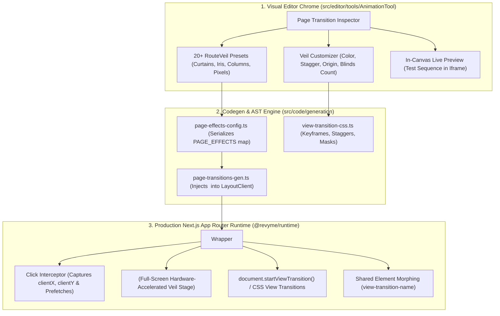

# RouteVeil Cinematic Transitions & Overlays: Architecture & Implementation Plan

> **Executive Summary:** A comprehensive technical architecture and step-by-step implementation plan to bring the complete transition engine of [RouteVeil](https://www.routeveil.dev) ([milkevich/routeveil](https://github.com/milkevich/routeveil)) into Revyme. This introduces **20+ cinematic transition effects**, full-screen **Veil Overlays** (curtains, multi-stripe blinds, matrix pixels, radial clock wipes, venetian louvers), **cursor-aware coordinate reveals**, and **shared-element layout morphs** directly into the Revyme visual website builder and its generated Next.js App Router codebase.

---

## 1. Vision & Architecture Overview

[RouteVeil](https://www.routeveil.dev) represents the state of the art in modern web page transitions: decoupling page animation logic from individual screen components and coordinating transitions through a high-performance, cinematic visual handoff.

While RouteVeil was designed specifically as an engine for React Router (SPA), Revyme generates production-ready **Next.js App Router** code. This architecture plan translates the aesthetic and functional capabilities of RouteVeil into a native, high-performance Next.js App Router implementation that runs on the web platform's **View Transitions API**, hardware-accelerated CSS clip paths, and Framer Motion (`motion` v12, already bundled in Revyme).



---

## 2. Complete RouteVeil Effect Taxonomy (20 Effects)

RouteVeil classifies its transition effects into two primary categories: **Page-Level View Transitions** (animating the routed content container itself) and **Full-Screen Overlay Veils** (full-viewport graphic layers that mask the transition between pages).

### 2.1. Category A: Page-Level View Transitions (8 Effects)

These effects manipulate the outgoing and incoming page stages directly:

| # | Effect ID | Name | Visual Behavior | Primary CSS / Transform Mechanism |
|---|---|---|---|---|
| 1 | `fade` | **Crossfade** | Quiet opacity crossfade between outgoing and incoming routes. | `opacity: 1 → 0` (exit) / `opacity: 0 → 1` (enter) |
| 2 | `blur` | **Gaussian Soften** | Complete route blurs out and resolves into focus. | `filter: blur(0px) → blur(16px)` with scale settle |
| 3 | `slide` | **Directional Slide** | Smooth directional shift (`left`, `right`, `up`, `down`) with spring deceleration. | `translate3d(±100%, 0, 0)` with spring curve |
| 4 | `spin` | **3D Perspective Wheel** | Rotates out on the Y-axis as if turning a 3D polygonal pillar. | `perspective(1200px) rotateY(±90deg)` with origin |
| 5 | `rotate` | **Planar Turn** | Restrained 2D rotational swing around a bottom or center anchor. | `rotate(0deg → ±12deg)` with slight zoom back |
| 6 | `bounce` | **Depth Bounce** | Soft depth recession and forward spring snap. | `scale: 1 → 0.93 → 1.02 → 1` with spring damping |
| 7 | `push` | **Parallax Push** | Outgoing page recedes slightly ($0.4\times$ speed) while incoming advances over it. | Asymmetric exit/enter transform rates |
| 8 | `pull` | **Depth Pull** | Outgoing page fades back while incoming page is drawn forward from depth. | Incoming starts at `scale: 0.88`, `brightness: 0.7` |

---

### 2.2. Category B: Full-Screen Overlay Transitions — "The Veils" (12 Effects)

These effects deploy a dedicated graphic overlay layer (`<VeilOverlay>`) over the entire viewport during navigation. The veil obscures the screen during the Next.js router commit, eliminating content flash and providing dramatic, cinematic rhythm.

| # | Effect ID | Name | Visual Behavior | Implementation Technique |
|---|---|---|---|---|
| 9 | `curtain` | **Bi-Parting Curtain** | Two opposing panels meet in the center and part open. | Dual panels with `scaleX(0 → 1 → 0)` or `translateY` |
| 10 | `wipe` | **Monolithic Wipe** | Single solid or gradient curtain sweeping across the screen. | `translate3d(-100% → 0% → 100%)` |
| 11 | `columns` | **Staggered Blinds** | $N$ vertical columns ($5$ to $10$) dropping in a staggered wave. | CSS Grid with staggered column delays ($t_0 + i \cdot \Delta$) |
| 12 | `rows` | **Horizontal Louvers** | $M$ horizontal bars sweeping across in a sequenced cascade. | CSS Flexbox with staggered child row transitions |
| 13 | `iris` | **Aperture Iris** | Circular aperture contracting to a point, then expanding outward. | `clip-path: circle(150% → 0% → 150%)` |
| 14 | `halo` | **Expanding Ripple** | Solid circular veil exploding outward from the exact click location. | `clip-path: circle(0% at var(--click-x) var(--click-y))` |
| 15 | `tunnel` | **Continuous Tunnel** | A halo cover flows seamlessly into an iris reveal. | Coordinated entry/exit circle clip paths |
| 16 | `clock` | **Conic Sector Sweep** | Radial sector sweeps $360^\circ$ around the viewport like a radar hand. | `clip-path: polygon(...)` or dynamic SVG conic mask |
| 17 | `venetian` | **3D Venetian Blinds** | Slices of the viewport rotate $90^\circ$ on their axes to conceal and reveal. | 3D transform on parallel strips with perspective |
| 18 | `pixel` | **Matrix Tile Field** | Grid of square tiles radiating outward from the click origin. | CSS Grid of tiles calculated by distance from $(x, y)$ |
| 19 | `mosaic` | **Geometric Shards** | Seeded polygonal pieces lock into a solid field and shatter away. | SVG polygon morph / staggered polygonal clip-paths |
| 20 | `dissolve` | **Film Grain Dissolve** | Procedural film grain/noise resolves into solid tone and resolves out. | SVG turbulence filter + threshold opacity ramp |

---

### 2.3. Advanced Dynamics & RouteVeil Capabilities

Beyond preset animations, the RouteVeil architecture incorporates three critical capabilities:

1. **Cursor-Aware Coordinates:**
   When an internal link is clicked, the exact client coordinates $(x, y)$ are captured. Transition origins are pinned to `--click-x: ${e.clientX}px` and `--click-y: ${e.clientY}px`. Effects like `halo`, `iris`, and `pixel` radiate directly from where the user tapped or clicked.
2. **Shared-Element Morphing:**
   Matching visual elements across routes (e.g. product thumbnail in a collection grid $\rightarrow$ hero image on the product detail page) remain continuous. Handled via the browser's native View Transitions API using matching `view-transition-name` identifiers.
3. **Accessibility & Reduced Motion:**
   Automatic zero-latency override: when `window.matchMedia('(prefers-reduced-motion: reduce)')` is active, all veils and transform animations bypass instantly into an imperceptible $100\text{ms}$ crossfade or instant cut.

---

## 3. Current Revyme Codebase Audit & Gap Analysis

Revyme already possesses a robust foundation in `src/code/generation/page-transitions-gen.ts` and `src/code/project/page-effects-config.ts`. However, several architectural gaps must be bridged to achieve RouteVeil parity:

| Area | Current Revyme State | RouteVeil Requirement | Gap to Bridge |
|---|---|---|---|
| **Transition Scope** | Page-level stage and cloned exit container only (`revyme-pt-enter`, `revyme-pt-exit`). | Full-screen independent graphic overlay (`<VeilOverlay>`) operating above both layout and pages. | Scaffold a persistent `<VeilStage>` portal inside `<PageTransitions>` with independent lifecycle state. |
| **Presets** | 10 basic presets (`crossfade`, `slide-*`, `push-*`, `wipe-*`). | 20 cinematic presets including curtains, columns, venetian blinds, and matrix pixels. | Implement the 10 additional veil generators in `view-transition-css.ts` and `page-effects-runtime.ts`. |
| **Click Coordinate Tracking** | Click events are captured for prefetching and routing, but coordinates $(x, y)$ are discarded. | Coordinate-aware origins (`cursor`, `center`, `corners`) driving radial masks and pixel ripples. | Capture `e.clientX`, `e.clientY` in link interceptor and publish as CSS variables `--click-x`, `--click-y`. |
| **Shared Elements** | No UI or codegen for linking elements across routes. | Continuous visual morphing of marked images, cards, and titles between pages. | Add `viewTransitionName` attribute in AST/Inspector and emit CSS `@view-transition` rules. |
| **Animation Panel UI** | Basic preset dropdown and easing curve inputs. | Categorized preset picker, Veil color picker, column/row count slider, and origin selector. | Upgrade `src/editor/tools/AnimationTool` with a dedicated "Veil & Overlay" configuration panel. |
| **Canvas Live Preview** | Testing transitions requires live deployment or running the external Next.js dev server. | In-canvas transition preview directly inside the builder iframe. | Add a "Preview Transition" simulator in `AnimationTool` that triggers the veil sequence locally. |

---

## 4. Architectural & Implementation Plan

```mermaid
sequenceDiagram
    autonumber
    actor User as Designer / Visitor
    participant Link as <a href="/projects">
    participant Interceptor as Link Interceptor
    participant Veil as <VeilStage>
    participant NextRouter as Next.js App Router
    participant Canvas as Page View / Canvas

    User->>Link: Clicks link
    Link->>Interceptor: onClick(e)
    Interceptor->>Interceptor: Capture e.clientX, e.clientY
    Interceptor->>Veil: Trigger Veil In (curtain / columns / halo)
    Note over Veil: Veil covers viewport (0.3s)
    Veil->>NextRouter: router.push('/projects')
    NextRouter->>Canvas: Mounts incoming page in background
    Canvas-->>Veil: onMounted / pathname changed
    Veil->>Veil: Trigger Veil Out (reveal new page)
    Note over Canvas: New page revealed cleanly (0.3s)
    Veil-->>User: Interaction complete
```

---

### Phase 1: Data Model & Schema Extension

**Target Files:**
- `src/code/project/page-effects-config.ts`
- `src/code/project/page-effects-config.test.ts`
- `src/code/generation/view-transition-css.ts`

#### 1.1. Data Model Enhancements
Extend `page-effects-config.ts` with explicit `VeilConfig` and `SharedElementConfig` interfaces:

```ts
export type VeilType =
  | 'none'
  | 'curtain'     // Bi-parting horizontal/vertical panels
  | 'wipe'        // Single full-screen sweeping slab
  | 'columns'     // Staggered vertical blinds (N strips)
  | 'rows'        // Staggered horizontal louvers (M strips)
  | 'iris'        // Contracting and expanding circular aperture
  | 'halo'        // Expanding solid circular bubble from click origin
  | 'tunnel'      // Inward halo transitioning into outward iris
  | 'clock'       // 360-degree radial conic sector sweep
  | 'venetian'    // 3D flipping blinds
  | 'pixel'       // Matrix tile field radiating from click point
  | 'mosaic'      // Procedural geometric shards
  | 'dissolve';   // Film-grain noise threshold dissolve

export type VeilOrigin = 'cursor' | 'center' | 'top' | 'bottom' | 'left' | 'right';

export interface VeilConfig {
  type: VeilType;
  color?: string;           // Custom hex, rgba, or CSS var (e.g. 'var(--accent)')
  backdropBlur?: number;    // px blur on underlying page during veil
  count?: number;           // Number of columns/rows (e.g. 5, 8, 12)
  stagger?: number;         // Delay between strips/tiles in seconds (e.g. 0.04)
  origin?: VeilOrigin;      // Interaction point or fixed anchor
  duration?: number;        // Total entrance/exit duration in seconds
  easing?: string;          // Easing curve (cubic-bezier or spring)
}

export interface SharedElementConfig {
  id: string;               // Unique transition tag, e.g. "project-hero-123"
  scope?: 'image' | 'text' | 'box';
}

export interface PageEffect {
  preset: string;
  target: string;
  exit?: SideConfig;
  enter?: SideConfig;
  veil?: VeilConfig;        // Added: Full-screen overlay veil specification
}
```

#### 1.2. Preset Registration
Add all 20 presets into `view-transition-css.ts`:
- Category 1: `fade`, `blur`, `slide-left`, `slide-right`, `slide-up`, `slide-down`, `spin`, `rotate`, `bounce`, `push`, `pull`.
- Category 2 (Veils): `veil-curtain`, `veil-wipe`, `veil-columns`, `veil-rows`, `veil-iris`, `veil-halo`, `veil-tunnel`, `veil-clock`, `veil-venetian`, `veil-pixel`, `veil-mosaic`, `veil-dissolve`.

---

### Phase 2: High-Performance Next.js Runtime Generation

**Target Files:**
- `src/code/generation/page-transitions-gen.ts`
- `src/code/generation/page-effects-runtime.ts`

#### 2.1. Coordinate Capture in Link Interceptor
Update the client-side link click handler in `page-transitions.tsx` to record coordinate data:

```ts
function onClick(e: MouseEvent) {
  const a = (e.target as Element)?.closest?.('a[href]') as HTMLAnchorElement | null;
  if (!a || e.defaultPrevented || e.button !== 0) return;
  
  // Store click coordinates relative to viewport
  const clickX = e.clientX;
  const clickY = e.clientY;
  document.documentElement.style.setProperty('--click-x', `${clickX}px`);
  document.documentElement.style.setProperty('--click-y', `${clickY}px`);
  document.documentElement.style.setProperty('--click-xp', `${(clickX / window.innerWidth) * 100}%`);
  document.documentElement.style.setProperty('--click-yp', `${(clickY / window.innerHeight) * 100}%`);
  
  // Trigger veil lifecycle prior to route commit
  const eff = resolvePageEffect(PAGE_EFFECTS, location.pathname, dest.pathname);
  if (eff?.veil && eff.veil.type !== 'none') {
    triggerVeil(eff.veil, () => router.push(dest.href));
    e.preventDefault();
  }
}
```

#### 2.2. Dedicated `<VeilStage>` Component
Generate `<VeilStage>` alongside `<PageTransitions>`:
- Uses a fixed container: `position: fixed; inset: 0; z-index: 99999; pointer-events: none;`.
- Renders lightweight DOM according to `veil.type`:
  - **Columns/Rows:** Generates $N$ empty `<div>` strips styled with flexbox/grid and calculated CSS variable `--stagger-idx`.
  - **Iris / Halo / Tunnel:** Single full-screen div animated via hardware-accelerated CSS `clip-path`.
  - **Venetian Blinds:** Strips with `transform-style: preserve-3d; perspective: 1000px;`.
  - **Pixel Grid:** 64-block lightweight grid with CSS `animation-delay` mapped to Euclidean distance $\sqrt{(x - x_0)^2 + (y - y_0)^2}$.

#### 2.3. Native View Transitions API Integration
For modern browsers (Chrome 111+, Edge, Safari 18+), integrate `document.startViewTransition()`:
- Automatically binds `view-transition-name` to elements carrying `data-vt-name`.
- Fallback to CSS animation for older browsers with zero code alterations.

---

### Phase 3: Visual Canvas Simulation (Editor Live Preview)

**Target Files:**
- `src/canvas/Renderer.ts`
- `src/canvas/canvas-bridge.ts`
- `src/editor/tools/AnimationTool/index.tsx`

Allow designers to test the page transition inside the editor without publishing or reloading:
1. Provide a **"Preview Transition"** button inside the Animation Tool.
2. Sends an IPC message across `canvas-bridge.ts` to the iframe sandbox:
   ```ts
   postToCanvas({ type: 'preview-page-transition', effect: activePageEffect });
   ```
3. Inside the iframe, the `<VeilStage>` executes its complete sequence (Veil In $\rightarrow$ Pause $\rightarrow$ Veil Out), giving immediate 60fps visual validation.

---

### Phase 4: Animation Tool UI Enhancements

**Target Files:**
- `src/editor/tools/AnimationTool/index.tsx`
- `src/editor/tools/AnimationTool/AddEffectDropdown.tsx`
- `src/editor/tools/AnimationTool/VeilConfigPopup.tsx` *(new)*

Enhance the Animation Tool panel:

1. **Categorized Preset Selector:**
   Group presets into:
   - *Classic View Motions* (Fade, Slide, Push, Pull, Blur, Spin, Bounce)
   - *Full-Screen Veils* (Curtain, Blinds, Columns, Rows, Iris, Halo, Clock, Venetian, Pixels)
   - *Custom Advanced*
2. **Veil Settings Card:**
   When a Veil effect is selected, show specialized controls:
   - **Veil Color:** Swatch control linked to `--accent`, `--bg-surface`, `--text-primary`, or custom color.
   - **Origin Selector:** Segmented control (`Cursor`, `Center`, `Top`, `Bottom`, `Left`, `Right`).
   - **Stripes / Tile Density:** Numeric stepper / slider (3 to 16 columns/bars).
   - **Stagger:** Timing slider (0.01s to 0.15s).
   - **Backdrop Blur:** Slider for frosted glass effect under the veil.

---

### Phase 5: Automation & AI Agent Tooling (MCP)

**Target Files:**
- `packages/automation-core/src/operations/site-effects.ts`
- `src/ai/agent/tools/index.ts`

Expose operations to AI agents via the Model Context Protocol (MCP):
- `siteEffects.pageTransition.set`: Updated to accept `veil: { type, color, count, origin, stagger }`.
- AI page-generation agents can author award-winning portfolios by executing:
  ```json
  {
    "action": "siteEffects.pageTransition.set",
    "params": {
      "preset": "veil-columns",
      "veil": {
        "type": "columns",
        "color": "var(--accent)",
        "count": 6,
        "stagger": 0.04,
        "origin": "cursor"
      }
    }
  }
  ```

---

### Phase 6: Performance Budget & Quality Verification

#### 6.1. Performance & Hardware Acceleration
- **Composite-Only Properties:** All animations MUST execute exclusively on the GPU compositor using `transform`, `opacity`, and `clip-path`. Zero layout reflow (`top`, `left`, `width`, `height` strictly forbidden in animations).
- **Target Frame Rate:** Guaranteed 60fps on mobile devices and 120fps on ProMotion displays.
- **Bundle Overhead Budget:** The entire runtime addition in `page-effects-runtime.ts` must remain under **3.5 KB minified / gzipped**.

#### 6.2. Test Suite Specifications
1. **Serialization & Parity Tests:**
   - Verify `page-effects-config.test.ts` roundtrips every new `VeilConfig` attribute through AST parse/serialize without loss.
   - Verify parity between `src/code/generation/view-transition-css.ts` and `page-effects-runtime.ts`.
2. **Reduced Motion Tests:**
   - Ensure `@media (prefers-reduced-motion: reduce)` tests pass: zero transform/clip-path animations executed when active.
3. **Cross-Browser Verification:**
   - Chrome/Edge: Native View Transitions + SVG/CSS clip-path.
   - Safari (Desktop & iOS): Hardware-accelerated `-webkit-clip-path` and WebKit backdrop-filter.
   - Firefox: Standards-compliant CSS clip-path and fallbacks.

---

## 5. Execution Roadmap

```
Week 1: Schema & Presets
  ├── Extend page-effects-config.ts with VeilConfig & VeilType
  ├── Implement mathematical keyframe generators in view-transition-css.ts
  └── Unit tests for 20 presets in page-effects-config.test.ts

Week 2: Next.js Runtime (<VeilStage>)
  ├── Implement client coordinate listener (clientX, clientY)
  ├── Build <VeilStage> renderer in page-transitions-gen.ts
  ├── Support Columns, Curtains, Iris, Halo, and Venetian louvers
  └── Wire reduced-motion guards & Next.js router synchronization

Week 3: Visual Editor UI & Preview
  ├── Upgrade AnimationTool dropdown with categorized RouteVeil presets
  ├── Implement VeilConfigPopup with color picker, count slider & origin selector
  └── Implement In-Canvas "Preview Transition" simulator via canvas-bridge

Week 4: Shared Elements & AI MCP Bridge
  ├── Implement data-vt-name attribute support for shared elements
  ├── Expose setVeil operations in automation-core
  └── End-to-end performance verification & Core Web Vitals audit
```

---

## 6. Summary

Implementing the RouteVeil engine into Revyme takes our website builder's visual capabilities from standard page switching to **cinematic, award-winning web motion**. By anchoring the implementation to Revyme's native Next.js App Router code generator and View Transitions API, we achieve RouteVeil's full aesthetic power with **zero heavy external dependencies, native SSR compatibility, and instant in-editor visual controls**.
