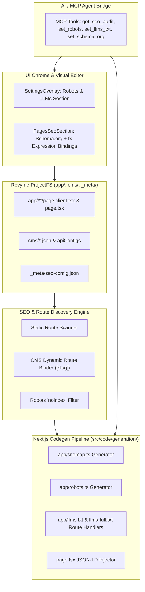

# Architecture & Implementation Plan: Zero-Config SEO, Robots, LLMs.txt, Schema.org (JSON-LD with fx Expressions), and MCP Agent Tooling

> **Target Platform:** Revyme Website Builder (Next.js App Router, ProjectFS, Jotai, Babel Generator Pipeline, Model Context Protocol).

---

## 1. Executive Summary

This plan provides a complete architecture and migration path to introduce full search engine and AI discovery capabilities into Revyme.

1. **Zero-Config Sitemap (`app/sitemap.ts`)**: Automatically discovers all static routes and CMS collections (both Local JSON and Headless API collections) using existing parameter mapping (`[slug]`, `[category]`). No redundant manual checkboxes.
2. **Robots Management (`app/robots.ts`)**: Built-in control for standard web bots (`Googlebot`, `Bingbot`) and AI agents (`GPTBot`, `ClaudeBot`, `PerplexityBot`), with automatic sitemap linking.
3. **AI Discovery Protocol (`app/llms.txt/route.ts` and `app/llms-full.txt/route.ts`)**: Generates structured Markdown feeds specifically tailored for AI search engines, Cursor, and LLM web crawlers.
4. **Visual Schema.org JSON-LD Editor with `fx` Expressions**: Allows developers and designers to attach structured data (`Article`, `Product`, `Organization`, `FAQPage`) to pages and CMS detail pages, manually binding fields with **full `fx` expressions support** (e.g., `item.title + ' | Store'`, `formatDate(item.date)`).
5. **Full MCP Server Integration**: Equips AI agents operating over MCP with first-class tools to audit, configure, and inspect SEO, Robots policies, LLMs documentation, and JSON-LD structured schemas.

---

## 2. System Architecture



---

## 3. Core Modules Specification

### 3.1. Zero-Config Sitemap (`app/sitemap.ts`)

#### Discovery Rules
1. **Static Routes**: Every `app/**/page.client.tsx` (excluding `(route-groups)` syntax from URLs).
2. **Dynamic Routes**:
   * Inspects `[slug]` patterns in `app/`.
   * For **Local CMS** (`cms/<slug>.json`): Directly imports the JSON and iterates over items where `_status !== 'draft'`.
   * For **Headless API CMS** (`apiConfigs`): Generates a secure server-side fetching routine using the collection's configured endpoint, items selector, and headers. Cached via Next.js ISR (`revalidate: 3600`).
3. **Noindex Respect**: Automatically drops any route where `metadata.robots.index === false` or `item.noindex === true`.
4. **Locales (i18n)**: Automatically attaches `alternates.languages` for multilingual sites configured under `app/[locale]/`.

#### Generated Code Sample
```ts
import type { MetadataRoute } from 'next';
import blogItems from '@/cms/blog.json';

export default async function sitemap(): Promise<MetadataRoute.Sitemap> {
  const baseUrl = process.env.NEXT_PUBLIC_SITE_URL || 'https://example.com';

  const staticUrls: MetadataRoute.Sitemap = [
    { url: `${baseUrl}`, lastModified: new Date(), changeFrequency: 'daily', priority: 1.0 },
    { url: `${baseUrl}/about`, lastModified: new Date(), changeFrequency: 'monthly', priority: 0.8 },
  ];

  const blogUrls: MetadataRoute.Sitemap = (blogItems as any[])
    .filter(item => item._status !== 'draft')
    .map(item => ({
      url: `${baseUrl}/blog/${item.slug}`,
      lastModified: item.updatedAt ? new Date(item.updatedAt) : new Date(),
      changeFrequency: 'weekly',
      priority: 0.7,
    }));

  return [...staticUrls, ...blogUrls];
}
```

---

### 3.2. Robots Management (`app/robots.ts`)

#### Storage & Configuration
Stored in `_meta/robots.json` (and compiled to `app/robots.ts`):
* `mode`: `'allow_all' | 'disallow_all' | 'custom'`
* `disallowPaths`: `string[]` (e.g. `['/api/', '/admin/']`)
* `aiBotPolicies`: Record of crawler flags (`gptBot`, `claudeBot`, `perplexityBot`, `googleExtended`).

#### Visual Editor
Integrated into **SettingsOverlay → General → Website / SEO**:
* Preset toggles: **Live / Public Site** vs **Staging / Private** (disallows `/`).
* **AI Crawlers Guard**: Granular switches to allow/block `GPTBot`, `ClaudeBot`, `PerplexityBot`.
* Auto-generated canonical `Sitemap: https://${baseUrl}/sitemap.xml`.

---

### 3.3. AI Discovery Protocol (`llms.txt` & `llms-full.txt`)

Following the open `/llms.txt` standard for LLMs and AI search engines:
1. **`app/llms.txt/route.ts`**: Provides a concise Markdown map of the site (Project title, summary, core URLs, brief descriptions).
2. **`app/llms-full.txt/route.ts`**: Provides the comprehensive site content in Markdown (including complete documentation or CMS post excerpts) for deep RAG ingestion.

#### Generation Logic
* Pulls site description and title from `app/layout.tsx`.
* Lists key landing pages.
* Automatically surfaces published CMS items (`/blog/[slug]` title + summary/excerpt).
* Endpoint served with `Content-Type: text/plain; charset=utf-8`.

---

### 3.4. Schema.org JSON-LD with Manual `fx` Expression Bindings

Instead of brittle auto-guesses, Revyme will provide a dedicated **Structured Data (Schema.org)** editor inside `PagesSeoSection.tsx`, giving full control with expression bindings.

#### Supported Schema Presets
* **Article / BlogPosting**: `headline`, `description`, `image`, `datePublished`, `dateModified`, `author.name`.
* **Product**: `name`, `description`, `image`, `sku`, `price`, `priceCurrency`, `availability`.
* **Organization / LocalBusiness**: `name`, `url`, `logo`, `contactPoint`, `sameAs`.
* **FAQPage**: `mainEntity` array of questions and answers.
* **Custom JSON-LD**: Raw JSON editor with inline `fx` token interpolation.

#### `fx` Expression Binding in Schema
Users can click the `fx` pill on any field in the schema to write dynamic expressions evaluated per CMS item:
* `headline`: `fx` -> `item.title`
* `description`: `fx` -> `item.summary || item.excerpt`
* `image`: `fx` -> `item.cover?.url || "https://example.com/fallback.png"`
* `datePublished`: `fx` -> `item.publishedAt || item.date`

#### Generated Server Wrapper Injection (`app/blog/[slug]/page.tsx`)
```tsx
export default async function Page({ params }: { params: Promise<{ slug: string }> }) {
  const { slug } = await params;
  const item = getItemBySlug(slug);

  const jsonLd = {
    '@context': 'https://schema.org',
    '@type': 'Article',
    headline: item?.title,
    description: item?.summary || item?.excerpt,
    image: item?.cover?.url,
    datePublished: item?.publishedAt || item?.date,
  };

  return (
    <>
      <script
        type="application/ld+json"
        dangerouslySetInnerHTML={{ __html: JSON.stringify(jsonLd) }}
      />
      <PageClient item={item} />
    </>
  );
}
```

---

## 4. MCP Agent Tooling & AI Capabilities

To make the AI agent fully autonomous over MCP, we extend the MCP tool suite in `src/ai/agent/tools/` and bridge manifests.

### New & Extended MCP Tools

| Tool Name | Action & Purpose | Parameters |
|---|---|---|
| `get_seo_audit` | Deep audit of site-wide & per-page SEO, sitemap health, robots policies, missing schema, and LLM readiness. | `{}` |
| `set_robots_config` | Configures `app/robots.ts` rules, disallow paths, and AI crawler permissions. | `{ mode, disallowPaths, aiBots: { gptBot, claudeBot, perplexityBot } }` |
| `configure_llms_txt` | Configures and updates `llms.txt` and `llms-full.txt` content, included sections, and summary. | `{ summary, sections, includeCmsCollections: string[] }` |
| `set_page_schema_org` | Configures Schema.org JSON-LD for a route, including static values and `fx` expression bindings for CMS detail pages. | `{ page, schemaType, fields, expressions: Record<string, string>, rawCustomJson }` |
| `sync_sitemap` | Triggers a fresh discovery run and preview validation for `app/sitemap.ts`. | `{}` |

### System Prompt & Skill Update
Update `.agents/skills/revyme-mcp/SKILL.md` and `src/ai/agent/skills-library.ts`:
* Document how agents should audit and set up `robots.txt` and `llms.txt`.
* Instruct agents on how to construct valid Schema.org entities (`Article`, `Product`, etc.) using `set_page_schema_org` with `fx` bindings for dynamic routes.

---

## 5. File Modifications Checklist

1. **`src/code/generation/sitemap-gen.ts`** *(New)*: Pure code generator for `app/sitemap.ts`.
2. **`src/code/generation/robots-gen.ts`** *(New)*: Pure code generator for `app/robots.ts`.
3. **`src/code/generation/llms-gen.ts`** *(New)*: Generator for `app/llms.txt/route.ts` and `app/llms-full.txt/route.ts`.
4. **`src/code/project/cms-seo.ts`**:
   * Extend `buildCmsDetailServerWrapper` to inject `<script type="application/ld+json">`.
   * Add `parseCmsSchemaBindings` and `parseCmsSchemaExpressions`.
5. **`src/cloud/settings/PagesSeoSection.tsx`**: Add Schema.org JSON-LD section with `ExpressionBoundPill` & `ExpressionEditorPopup`.
6. **`src/cloud/settings/WebsiteSeoSection.tsx`**: Add Robots.txt rules and LLMs.txt visual configuration.
7. **`src/code/project/source-export.ts`**: Hook automatic generation of `sitemap.ts`, `robots.ts`, and `llms.txt` into `prepareSiteFiles()`.
8. **`src/ai/agent/tools/seo-tools.ts`** *(New/Extended)*: Implement MCP tools for agents.
9. **`.agents/skills/revyme-mcp/SKILL.md`**: Update MCP reference documentation.

---

## 6. Implementation Stages & Verification

### Step 1: Core Code Generators & Tests
* Build unit tests for `sitemap-gen.test.ts`, `robots-gen.test.ts`, and `llms-gen.test.ts`.
* Validate that output modules pass Babel parse validation (`moduleParses`).

### Step 2: JSON-LD with Expressions Engine
* Implement `schemaBindings` and `schemaExpressions` AST parser and writer in `cms-seo.ts`.
* Unit test round-trip serialization and runtime execution with test fixtures.

### Step 3: Source Export Integration
* Connect generators to `prepareSiteFiles()` in `source-export.ts`.
* Verify that building a dynamic or hybrid project yields valid `app/sitemap.ts`, `app/robots.ts`, and `app/llms.txt/route.ts`.

### Step 4: UI Chrome Components
* Embed Schema.org panel in `PagesSeoSection.tsx`.
* Wire `ExpressionEditorPopup` to schema properties.
* Add Robots & LLMs controls in `SettingsOverlay.tsx`.

### Step 5: MCP Tool Manifest & Agent Skills
* Register `get_seo_audit`, `set_robots_config`, `configure_llms_txt`, `set_page_schema_org`.
* Verify agent behavior via `npx vitest run src/ai/agent/`.
