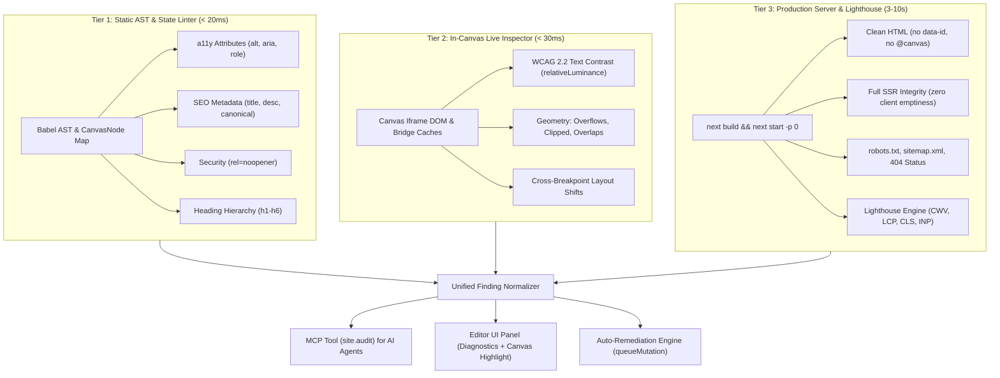
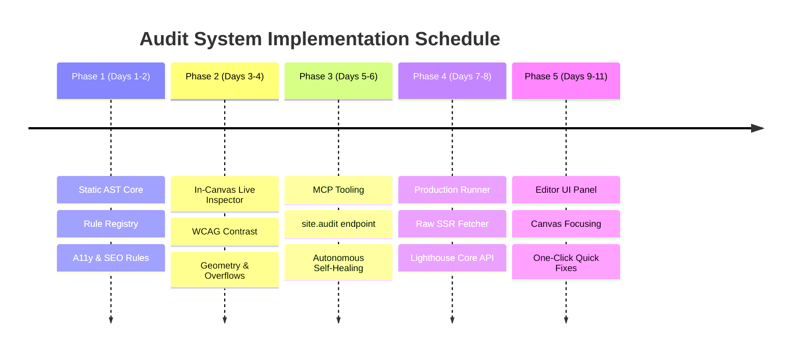

# Comprehensive Site Audit System: Architecture & Implementation Plan

> **Executive Summary:** A production-grade, automated audit system for Revyme (Next.js visual website builder). It inspects accessibility (WCAG 2.2 AA), technical SEO, production SSR clean-code integrity, security, typography, media optimization, and Core Web Vitals performance. The system operates across three tiers (Static AST, In-Canvas Runtime, and Production SSR/Lighthouse), provides native **Model Context Protocol (MCP)** integration for an autonomous AI self-healing loop, and delivers an intuitive in-editor diagnostic panel with one-click quick fixes.

---

## 1. Architectural Vision & Three-Tiered Model

The audit system operates on a **hybrid three-tiered model** designed to balance immediate authoring feedback with rigorous production verification:



### The Three Operational Tiers:

1. **Tier 1: Static AST & State Linter (< 20ms)**
   * Executes purely in-memory over Babel AST and the `CanvasNode` tree.
   * Runs continuously or on-demand without spinning up a browser.
   * Identifies missing attributes, malformed ARIA syntax, broken heading structures, missing metadata, and invalid JSON-LD.
2. **Tier 2: In-Canvas Live Inspector (< 30ms)**
   * Reads from the editor's existing iframe synchronization caches (`rectCache`, `computedCache` in `src/canvas/canvas-bridge.ts`).
   * Evaluates computed styles, WCAG 2.2 color contrast ratios, layout clipping (`overflow: hidden`), and viewport horizontal overflows (`scrollWidth > clientWidth`).
3. **Tier 3: Production Server & Lighthouse Runner (3–10s)**
   * Executes against an isolated, compiled Next.js production build (`next build && next start -p 0`).
   * Validates raw SSR HTTP responses (ensuring clean code without builder artifacts like `data-id` or `@canvas`), checks server status codes (no soft-404s), validates `robots.txt`/`sitemap.xml`, monitors console hydration errors, and measures official Google Core Web Vitals scores via the programmatic Lighthouse Core API.

---

## 2. Complete Audit Rulebook & Verification Matrix

### 2.1. Category A: Accessibility (WCAG 2.2 AA Compliance)

| Rule ID | Severity | Phase | Description | Remediation |
|---|---|---|---|---|
| `missing-alt` | **Error** | Static/SSR | `` or Next.js `<Image>` element lacks an `alt` attribute. | Add concise alt text describing the image, or `alt=""` if decorative. |
| `missing-image-input-alt` | **Error** | Static | `<input type="image">` button has no alt label. | Add an `alt` attribute describing the submit action. |
| `missing-iframe-title` | **Error** | Static | `<iframe>` element lacks an accessible `title` attribute. | Add a descriptive `title` attribute for screen readers. |
| `missing-accessible-name` | **Error** | Static/Live | Interactive control (`<button>`, `<a>`) has no text content, `aria-label`, `aria-labelledby`, or `title`. | Add visible text content or an explicit `aria-label`. |
| `missing-form-label` | **Error** | Static | Form control (`<input>`, `<select>`, `<textarea>`) is not associated with a `<label>` or `aria-label`. | Connect a `<label htmlFor="id">` or add `aria-label`. |
| `invalid-label-reference` | **Error** | Static | `<label htmlFor="id">` references a non-existent or non-labelable element. | Point `htmlFor` to a valid interactive control ID. |
| `duplicate-id` | **Error** | Static/SSR | Multiple elements on the same page share an identical static HTML `id`. | Ensure all HTML `id` values are unique across the page. |
| `missing-page-heading` | **Warning** | Static/SSR | Page contains no top-level `<h1>` element. | Add exactly one descriptive `<h1>` heading. |
| `multiple-page-headings` | **Warning** | Static/SSR | Page contains more than one `<h1>` element. | Maintain a single `<h1>` per page; demote secondary headings to `<h2>`. |
| `skipped-heading-level` | **Warning** | Static/SSR | Headings skip levels (e.g., `<h1>` immediately followed by `<h3>`). | Follow sequential heading order (`h1 -> h2 -> h3`). |
| `missing-main-landmark` | **Warning** | Static/SSR | Page lacks a semantic `<main>` landmark element. | Wrap primary content in a `<main>` container. |
| `multiple-main-landmarks`| **Warning** | Static/SSR | Page contains multiple `<main>` landmark elements. | Keep exactly one `<main>` landmark element per document. |
| `positive-tabindex` | **Warning** | Static | `tabIndex > 0` disrupts natural keyboard focus flow. | Rely on DOM order; use `tabIndex={0}` or `tabIndex={-1}`. |
| `aria-hidden-focusable` | **Error** | Static/Live | Element hidden from assistive technology (`aria-hidden="true"`) remains keyboard focusable. | Remove `aria-hidden` or remove element from focus order (`tabIndex={-1}`). |
| `invalid-aria-role` | **Error** | Static | Role attribute does not match W3C WAI-ARIA role definitions. | Use a valid ARIA role or remove the role attribute. |
| `missing-required-aria-role-property` | **Error** | Static | Role is missing mandatory state properties (e.g., `role="checkbox"` missing `aria-checked`). | Supply all required ARIA attributes for the explicit role. |
| `unsupported-aria-role-property` | **Warning** | Static | ARIA property is not supported by the declared role. | Remove unsupported attribute or select a compatible role. |
| `low-text-contrast` | **Warning** | Live/CDP | Text luminance ratio to background is below 4.5:1 (or 3.0:1 for large/bold text). | Adjust text foreground color or background to achieve WCAG AA contrast. |

---

### 2.2. Category B: SEO & Metadata (Search Engine Optimization)

| Rule ID | Severity | Phase | Description | Remediation |
|---|---|---|---|---|
| `empty-page-title` | **Error** | Static/SSR | Page title is missing, empty, or default boilerplate. | Supply a unique, descriptive page title (40–60 characters). |
| `missing-page-description` | **Warning** | Static/SSR | `<meta name="description">` is absent. | Provide a concise meta description summarizing page intent (120–160 characters). |
| `weak-page-description` | **Warning** | Static/SSR | Meta description is too short (< 50 chars) or excessively long (> 180 chars). | Optimize description length to fit search engine snippet limits. |
| `duplicate-page-title` | **Warning** | Cross-Page | Multiple routes share identical page titles. | Ensure every indexable route has a distinct, meaningful title. |
| `duplicate-page-description`| **Warning** | Cross-Page | Multiple routes share identical meta descriptions. | Customize descriptions per page to improve search result relevance. |
| `missing-canonical` | **Warning** | Static/SSR | Missing `<link rel="canonical" href="...">`. | Provide an absolute canonical URL to prevent duplicate content issues. |
| `invalid-page-language` | **Warning** | Static/SSR | `<html lang="...">` tag is missing or fails BCP-47 validation. | Set a valid BCP-47 language tag (e.g., `en`, `uk`, `de`). |
| `missing-social-image-asset`| **Warning** | Static/SSR | OpenGraph image (`og:image`) reference points to a missing or unresolved asset. | Point to an existing 1200x630px social preview image asset. |
| `invalid-json-ld` | **Error** | Static/SSR | JSON-LD structured data script contains malformed JSON. | Ensure JSON-LD content parses as valid JSON. |
| `missing-json-ld-context`| **Warning** | Static/SSR | JSON-LD schema root lacks `@context: "https://schema.org"`. | Include `@context: "https://schema.org"` in the structured data root. |
| `unknown-schema-org-type`| **Warning** | Static/SSR | Declared Schema.org `@type` is not recognized by the official vocabulary. | Use an active Schema.org entity type (e.g., `Organization`, `Article`). |
| `robots-txt-missing` | **Warning** | Production | Production server returns 404 for `/robots.txt`. | Ensure `robots.txt` exists and points to `sitemap.xml`. |
| `sitemap-xml-missing` | **Warning** | Production | Production server returns 404 for `/sitemap.xml`. | Generate and expose a valid XML sitemap. |
| `soft-404-detected` | **Error** | Production | Non-existent route returns HTTP 200 instead of HTTP 404. | Ensure unmatched routes trigger a true HTTP 404 response. |

---

### 2.3. Category C: Clean Production Code & SSR Integrity

| Rule ID | Severity | Phase | Description | Remediation |
|---|---|---|---|---|
| `builder-artifacts-in-prod` | **Error** | Production | Published HTML contains builder internals (`data-id=`, `@canvas`, internal editor wrappers). | Verify compiler stripping pass; ensure clean runtime output. |
| `empty-ssr-body` | **Error** | Production | Raw server HTML returns an empty body (client-only render fallback). | Ensure components execute and render markup during SSR/SSG. |
| `hydration-error-detected`| **Error** | Live/CDP | Browser console throws Next.js hydration mismatch errors. | Remove non-deterministic client-side values (e.g. unpinned dates, client-only window access) during initial render. |
| `excessive-div-nesting` | **Info** | Static/SSR | DOM tree contains excessive pure `<div>` nesting (> 15 levels deep). | Flatten component tree and use semantic containers. |

---

### 2.4. Category D: Performance & Core Web Vitals (CWV)

| Rule ID | Severity | Phase | Description | Remediation |
|---|---|---|---|---|
| `eager-below-fold-image` | **Warning** | Live/CDP | Image situated below the viewport fold lacks `loading="lazy"`. | Set `loading="lazy"` on below-the-fold media. |
| `missing-lcp-priority` | **Warning** | Live/CDP | The Largest Contentful Paint (LCP) hero image is lazy-loaded or lacks fetch priority. | Add `priority` or `fetchpriority="high"` to hero media. |
| `oversized-image` | **Warning** | Live/CDP | Natural image dimensions exceed rendered layout dimensions by > 2.5x. | Serve responsive image variants matching actual display bounds. |
| `missing-image-dimensions`| **Warning** | Static/SSR | `` lacks explicit `width`/`height` or CSS `aspect-ratio` (causes Cumulative Layout Shift). | Provide explicit aspect-ratio or dimensions. |
| `render-blocking-resource`| **Warning** | Production | Stylesheet or script in `<head>` blocks initial paint. | Add `defer`/`async` or inline critical path CSS. |
| `legacy-font-format` | **Info** | Production | Project serves `.ttf`, `.otf`, or `.woff` font files instead of modern `.woff2`. | Transcode fonts to `.woff2` and declare `font-display: swap`. |
| `horizontal-overflow` | **Error** | Live/CDP | Document width exceeds viewport (`scrollWidth > clientWidth`), causing horizontal scrollbars. | Constrain fixed-width containers to `max-width: 100%`. |
| `clipped-content` | **Warning** | Live/CDP | Parent with `overflow: hidden` clips text or actionable controls. | Adjust container sizing, padding, or text wrapping properties. |

---

### 2.5. Category E: Security

| Rule ID | Severity | Phase | Description | Remediation |
|---|---|---|---|---|
| `target-blank-without-noopener` | **Warning** | Static/SSR | Outbound link has `target="_blank"` without `rel="noopener"`. | Add `rel="noopener noreferrer"`. |
| `dangerous-external-link` | **Warning** | Static | External link uses insecure `http://` instead of `https://`. | Update URL scheme to `https://`. |

---

## 3. Directory Layout & Module Architecture

All auditing logic is organized in a self-contained directory: `src/code/audit/`:

```text
src/code/audit/
├── core/
│   ├── types.ts              # Zod schemas & TypeScript definitions
│   ├── registry.ts           # Comprehensive rule definitions, messages, remediation guides
│   └── normalizer.ts         # Finding deduplication, sorting by severity, ID generation
├── static/
│   ├── static-runner.ts      # Primary entry point for in-memory AST / CanvasNode map checks
│   ├── a11y-inspector.ts     # Image alt, ARIA attributes, button names, form labels
│   ├── heading-tree.ts       # Sequential heading validator (h1-h6) & landmark checks
│   ├── metadata-inspector.ts # Next.js page metadata, title, OG image, canonical, language
│   └── security-inspector.ts # Link target, noopener/noreferrer, protocol validation
├── rendered/
│   ├── canvas-linter.ts      # Reads bridge caches (rectCache, computedCache) from iframe
│   ├── contrast-engine.ts    # Relative luminance & WCAG 2.2 contrast ratio algorithms
│   └── geometry-linter.ts    # Overflows, clipping, element overlaps, oversized image detection
├── production/
│   ├── prod-runner.ts        # Orchestrates: build project, start server on port 0, terminate
│   ├── ssr-fetcher.ts        # High-speed cheerio/fetch raw HTML auditor
│   └── lighthouse-runner.ts  # Headless Chromium runner via programmatic Lighthouse Core API
├── remediation/
│   ├── auto-fixer.ts         # Dispatches safe AST mutations via queueMutation
│   └── fix-registry.ts       # Concrete remediation implementations for fixable rule IDs
└── mcp/
    └── audit-tool.ts         # MCP tool definition and request handler for AI agents
```

---

## 4. Data Contracts & Type Definitions

```typescript
// src/code/audit/core/types.ts
import { z } from 'zod';

export const AuditScope = z.enum([
  'accessibility',
  'seo',
  'performance',
  'security',
  'clean-code'
]);
export type AuditScope = z.infer<typeof AuditScope>;

export const AuditSeverity = z.enum(['error', 'warning', 'info']);
export type AuditSeverity = z.infer<typeof AuditSeverity>;

export const AuditLocation = z.object({
  pagePath: z.string(),
  nodeId: z.string().optional(),       // data-id in Revyme JSX / Canvas
  tag: z.string().optional(),
  propName: z.string().optional(),
  selector: z.string().optional(),
  line: z.number().optional(),
});
export type AuditLocation = z.infer<typeof AuditLocation>;

export const AuditFinding = z.object({
  id: z.string(),                      // Unique key: ${scope}/${ruleId}/${locationIdentity}
  scope: AuditScope,
  ruleId: z.string(),
  severity: AuditSeverity,
  title: z.string(),
  message: z.string(),
  explanation: z.string(),
  remediation: z.string(),             // Actionable instruction for human or AI agent
  location: AuditLocation,
  evidence: z.record(z.string(), z.unknown()).optional(),
  documentationUrl: z.string().url().optional(),
  canAutoFix: z.boolean().default(false),
});
export type AuditFinding = z.infer<typeof AuditFinding>;

export const AuditSummary = z.object({
  total: z.number(),
  bySeverity: z.record(AuditSeverity, z.number()),
  byScope: z.record(AuditScope, z.number()),
  scores: z.object({
    accessibility: z.number().min(0).max(100),
    seo: z.number().min(0).max(100),
    performance: z.number().min(0).max(100),
    bestPractices: z.number().min(0).max(100),
  }).optional(),
});
export type AuditSummary = z.infer<typeof AuditSummary>;

export const SkippedAuditCheck = z.object({
  ruleId: z.string(),
  reason: z.enum(['dynamic-expression', 'unsupported-component']),
  location: AuditLocation,
});
export type SkippedAuditCheck = z.infer<typeof SkippedAuditCheck>;

export const AuditResult = z.object({
  summary: AuditSummary,
  findings: z.array(AuditFinding),
  skippedChecks: z.array(SkippedAuditCheck),
});
export type AuditResult = z.infer<typeof AuditResult>;
```

---

## 5. Model Context Protocol (MCP) Integration & Autonomous Self-Healing

The audit capability is exposed to AI coding assistants (Claude Desktop, Cursor, Antigravity, or in-app conversational agents) as a first-class MCP tool.

### 5.1. Tool Definition

```typescript
// src/code/audit/mcp/audit-tool.ts
export const auditToolDefinition = {
  name: "site.audit",
  description: "Runs an end-to-end audit for accessibility, SEO, performance, clean code, and security. Supports static AST inspection, in-canvas runtime analysis, and full production build verification.",
  inputSchema: {
    type: "object",
    properties: {
      pagePath: {
        type: "string",
        description: "Target route (e.g. / or /pricing). Defaults to entire project."
      },
      scopes: {
        type: "array",
        items: { enum: ["accessibility", "seo", "performance", "security", "clean-code"] },
        description: "Audit scopes to include. Defaults to all standard scopes."
      },
      mode: {
        type: "string",
        enum: ["static", "rendered", "full-production"],
        default: "rendered",
        description: "Audit depth: 'static' (fast AST, <20ms), 'rendered' (in-canvas DOM, <50ms), or 'full-production' (Next.js server + Lighthouse, ~5s)."
      },
      autoFix: {
        type: "boolean",
        default: false,
        description: "If true, automatically applies safe codegen patches for all fixable findings."
      }
    }
  }
};
```

### 5.2. Autonomous Self-Healing Loop

```mermaid
sequenceDiagram
    autonumber
    actor User
    participant AI as AI Coding Assistant
    participant MCP as Revyme MCP Server
    participant Audit as Audit Engine
    participant MutQueue as Mutation Queue

    User->>AI: "Audit /pricing and fix all SEO and a11y issues"
    AI->>MCP: call_tool("site.audit", { pagePath: "/pricing", mode: "full-production" })
    MCP->>Audit: Run Production Build & Lighthouse
    Audit-->>MCP: AuditResult (Scores: SEO 78, A11y 82; Findings: missing-alt, low-contrast, missing-desc)
    MCP-->>AI: Structured Findings with nodeIds and remediation
    
    rect rgb(240, 248, 255)
        note over AI,MutQueue: Autonomous Remediation Step
        AI->>MutQueue: Apply safe fixes (add alt, update button color, set meta description)
        MutQueue-->>AI: Mutation confirmed & ProjectFS updated
    end

    AI->>MCP: call_tool("site.audit", { pagePath: "/pricing", mode: "static" })
    Audit-->>MCP: AuditResult (Scores: SEO 100, A11y 100; 0 Findings)
    MCP-->>AI: Re-verification passed
    AI-->>User: "Audit complete. Fixed 3 issues. SEO and A11y scores are now 100/100."
```

---

## 6. Production Server Runner & Lighthouse Implementation

### 6.1. High-Speed SSR Fetcher (`production/ssr-fetcher.ts`)
Executes an immediate HTTP GET request (`< 100ms`) using `cheerio` to inspect the raw HTML output sent to web crawlers:

```typescript
import * as cheerio from 'cheerio';
import type { AuditFinding } from '../core/types';

export async function auditRawServerHtml(baseUrl: string, route: string): Promise<AuditFinding[]> {
  const url = `${baseUrl}${route}`;
  const response = await fetch(url, {
    headers: { 'User-Agent': 'Googlebot/2.1 (+http://www.google.com/bot.html)' }
  });
  
  const rawHtml = await response.text();
  const $ = cheerio.load(rawHtml);
  const findings: AuditFinding[] = [];

  // Check 1: Builder Artifacts in Production
  if (rawHtml.includes('data-id=') || rawHtml.includes('@canvas')) {
    findings.push({
      id: `${route}/clean-code/builder-artifacts-in-prod`,
      scope: 'clean-code',
      ruleId: 'builder-artifacts-in-prod',
      severity: 'error',
      title: 'Builder artifacts found in production HTML',
      message: 'Published HTML contains internal attributes (data-id or @canvas).',
      explanation: 'Production HTML must be clean and unencumbered by builder internals.',
      remediation: 'Verify build-pipeline compiler transforms to ensure internal attributes are stripped.',
      location: { pagePath: route },
      canAutoFix: false,
    });
  }

  // Check 2: SSR Body Emptiness
  const bodyText = $('body').text().trim();
  if (bodyText.length === 0) {
    findings.push({
      id: `${route}/clean-code/empty-ssr-body`,
      scope: 'clean-code',
      ruleId: 'empty-ssr-body',
      severity: 'error',
      title: 'Empty server-rendered HTML body',
      message: 'Page body yielded zero text during server rendering.',
      explanation: 'Search crawlers require pre-rendered HTML content for indexing.',
      remediation: 'Ensure components support server-side rendering and do not defer all rendering to client hooks.',
      location: { pagePath: route },
      canAutoFix: false,
    });
  }

  // Check 3: Essential Head Metadata
  if (!$('title').text().trim()) {
    findings.push({
      id: `${route}/seo/empty-page-title`,
      scope: 'seo',
      ruleId: 'empty-page-title',
      severity: 'error',
      title: 'Missing page title',
      message: 'Document contains no non-empty <title> tag.',
      explanation: 'Page title is a critical ranking factor and displays in browser tabs.',
      remediation: 'Set title in page metadata.',
      location: { pagePath: route },
      canAutoFix: true,
    });
  }

  return findings;
}
```

### 6.2. Programmatic Lighthouse Integration (`production/lighthouse-runner.ts`)
Executes an automated, isolated Chromium session:

```typescript
import lighthouse from 'lighthouse';
import * as chromeLauncher from 'chrome-launcher';

export async function runLighthouseAudit(url: string) {
  const chrome = await chromeLauncher.launch({
    chromeFlags: ['--headless', '--disable-gpu', '--no-sandbox']
  });

  try {
    const runnerResult = await lighthouse(url, {
      port: chrome.port,
      onlyCategories: ['performance', 'accessibility', 'best-practices', 'seo'],
      output: 'json',
    });

    const lhr = runnerResult?.lhr;
    return {
      scores: {
        performance: Math.round((lhr?.categories.performance?.score ?? 0) * 100),
        accessibility: Math.round((lhr?.categories.accessibility?.score ?? 0) * 100),
        bestPractices: Math.round((lhr?.categories['best-practices']?.score ?? 0) * 100),
        seo: Math.round((lhr?.categories.seo?.score ?? 0) * 100),
      },
      audits: lhr?.audits ?? {},
    };
  } finally {
    await chrome.kill();
  }
}
```

---

## 7. In-Editor User Interface & Quick-Fixes

1. **Diagnostic Header Pill & Sidebar Tab:**
   * A persistent status indicator in the top toolbar displays error and warning counters (e.g. `🔴 2  🟡 4`).
   * Clicking the pill opens the dedicated **Audit** panel in the editor drawer.
2. **Interactive Finding List:**
   * Filterable by scope: `Accessibility`, `SEO`, `Performance`, `Clean Code`.
   * Grouped by severity (`Error`, `Warning`, `Info`).
3. **Canvas Element Focusing:**
   * Selecting a finding dispatches `selectNode(nodeId)` and smoothly scrolls the canvas camera to frame the offending element.
4. **One-Click Quick Fixes:**
   * Rules marked `canAutoFix: true` display a `Fix` button.
   * Clicking dispatches an exact mutation through `queueMutation`:
     * `target-blank-without-noopener` ➔ injects `rel="noopener noreferrer"`.
     * `missing-alt` ➔ injects decorative `alt=""` or triggers Vision AI description.
     * `skipped-heading-level` ➔ adjusts heading tag (e.g. `h3` ➔ `h2`).

---

## 8. Implementation Roadmap & Milestones



### Phase 1: Static AST Engine & Fundamental Rules (Days 1–2)
* Establish `src/code/audit/core/types.ts` and `registry.ts`.
* Implement `static-runner.ts` covering AST inspection:
  * Missing `alt`, accessible control names, form label references.
  * Heading tree sequential validation (`h1 -> h2 -> h3`).
  * Page metadata (`title`, `description`, `canonical`, `lang`).
  * Link security (`rel="noopener"`).
* Full unit test suite via `vitest`.

### Phase 2: In-Canvas Live Inspector (Days 3–4)
* Connect to `src/ai/agent/tools/design-audit.ts` primitives and bridge caches.
* Implement WCAG 2.2 color contrast calculations (`relativeLuminance`).
* Detect layout bugs: horizontal viewport overflow, clipped overflow, overlapping boxes.
* Detect media issues: oversized image dimensions, below-fold eager loading.

### Phase 3: MCP Tooling & Self-Healing Loop (Days 5–6)
* Register `site.audit` tool in Revyme's MCP server.
* Expose structured JSON results with node IDs and remediation guidance.
* Build automated codegen patchers for auto-fixable findings.

### Phase 4: Production Server Runner & Lighthouse API (Days 7–8)
* Build ephemeral production preview server manager (`next start -p 0`).
* Implement `ssr-fetcher.ts` with `cheerio` for instant clean-code & SSR verification.
* Integrate programmatic `lighthouse` runner for official Google CWV scoring.

### Phase 5: Editor Diagnostic UI & Canvas Highlights (Days 9–11)
* Create React diagnostic panel in the builder sidebar.
* Implement canvas element selection and camera focusing upon clicking findings.
* Add one-click "Quick Fix" buttons executing safe mutations.
