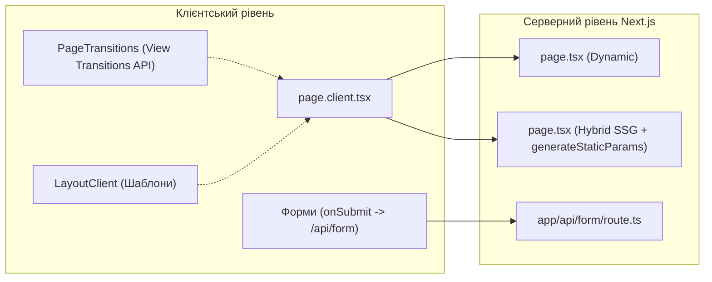

# План реалізації: Два варіанти експорту Next.js (Dynamic vs Hybrid SSG)

---

## 1. Загальна концепція та цілі

У дропдауні експорту Revyme пропонуватимуться два варіанти повноцінного проєкту Next.js:

1. **Next.js (Dynamic)** *(Поточний варіант)*
   * Динамічні CMS-сторінки (`app/**/[slug]/page.tsx`) не містять `generateStaticParams()`.
   * Сторінки деталей рендеряться на сервері (SSR) або обробляються клієнтом за запитом.
   * Максимально швидка збірка (`next build`), оскільки сторінки CMS не пререндеритися наперед.

2. **Next.js (Hybrid SSG)** *(Новий гібридний варіант)*
   * Для всіх динамічних CMS-сторінок автоматично генерується `generateStaticParams()`.
   * Під час `next build` Next.js пререндерить статичні HTML-файли для кожного запису в колекціях.
   * **Зберігається повноцінний серверний шар Next.js:** форми [`/api/form`](file:///D:/revyme-fork/revyme-builder-fork/src/code/generation/form-gen.ts#L27-L40), оптимізація картинок через `next/image` та динамічні API-роути **працюють штатно**.
   * Ідеальний TTFB та SEO без будь-яких втрат функціоналу.

> [!NOTE]
> Варіант «Pure Static» (`output: 'export'`) відхилено. Обидва варіанти залишаються повноцінними Next.js проєктами для запуску на Vercel, Node.js або Cloudflare OpenNext.

---

## 2. Порівняння двох варіантів

| Критерій | 1. Next.js (Dynamic) | 2. Next.js (Hybrid SSG) |
| :--- | :--- | :--- |
| **Код CMS `page.tsx`** | Стандартний шелл без `generateStaticParams` | Додається експорт `generateStaticParams()` |
| **Генерація HTML деталей CMS** | На льоту при запиті (SSR) | **Наперед під час білду (SSG)** |
| **SEO та швидкість TTFB** | Добре (залежить від швидкості сервера) | **Максимально швидко (готовий HTML з CDN)** |
| **Форми Revyme (`/api/form`)** | ✅ Працюють | ✅ **Працюють ідентично** |
| **Page Templates & Transitions** | ✅ Працюють | ✅ **Працюють ідентично** |
| **Час збірки (`next build`)** | Мінімальний | Залежить від кількості елементів у CMS |
| **Хостинг** | Vercel, Node.js, Serverless | Vercel, Node.js, Serverless |

---

## 3. Взаємодія з підсистемами Revyme



1. **Page Templates (`LayoutClient`):**
   * Як у Dynamic, так і в Hybrid режимі структура маршрутів залишається незмінною (`app/([group])/layout.tsx`). Під час навігації спільний шаблон не перемонтовується.
2. **Page Transitions (`PageTransitions`):**
   * Працюють через `document.startViewTransition()` та `router.push()`. В Hybrid-режимі завдяки попередньо скомпільованим статичним чанкам переходи відбуваються навіть плавніше.
3. **Форми зворотного зв'язку:**
   * В обох варіантах залишається активним ендпоінт `app/api/form/route.ts`. Клієнтський обробник форми успішно робить `POST /api/form`.

---

## 4. Покроковий план технічної реалізації

### Етап 1: Оновлення типів та інтерфейсу дропдауну
- [ ] **Файл:** [`src/editor/header/ExportDropdown.tsx`](file:///D:/revyme-fork/revyme-builder-fork/src/editor/header/ExportDropdown.tsx)
  * Додати новий формат у тип:
    ```ts
    export type ExportFormat = 'source' | 'source-ssg' | 'vite' | 'static' | 'tailwind';
    ```
  * Оновити конфігурацію `FORMATS`:
    ```ts
    {
      id: 'source',
      label: 'Next.js (Dynamic)',
      sublabel: 'Standard server-rendered routes',
      minPlan: 'free',
      icon: <NextLogo size={18} />,
    },
    {
      id: 'source-ssg',
      label: 'Next.js (Hybrid SSG)',
      sublabel: 'Pre-rendered pages + dynamic forms',
      minPlan: 'free',
      icon: <NextLogo size={18} />,
    },
    ```

---

### Етап 2: Генератор `generateStaticParams` для CMS
- [ ] **Файл:** [`src/code/project/cms-seo.ts`](file:///D:/revyme-fork/revyme-builder-fork/src/code/project/cms-seo.ts)
  * Додати опцію `includeStaticParams?: boolean` в інтерфейс `BuildDetailWrapperInput`.
  * Якщо `includeStaticParams === true`, генерувати функцію:
    ```tsx
    export async function generateStaticParams() {
      const items = Array.isArray(${varName}) ? ${varName} : [];
      return items
        .filter((i) => i && i._slug)
        .map((i) => ({ slug: String(i._slug) }));
    }
    ```

---

### Етап 3: Підтримка мультиязичності (i18n)
- [ ] **Файл:** [`src/code/project/locale-route-ops.ts`](file:///D:/revyme-fork/revyme-builder-fork/src/code/project/locale-route-ops.ts)
  * Для динамічних CMS-сторінок у мовних обгортках реекспортувати `generateStaticParams`:
    ```tsx
    export { default, generateStaticParams } from '@/${pageDir}/page';
    ```
  * Це забезпечить статичну генерацію іншомовних сторінок (наприклад, `/fr/blog/[slug]`).

---

### Етап 4: Логіка складання архіву
- [ ] **Файл:** [`src/code/project/source-export.ts`](file:///D:/revyme-fork/revyme-builder-fork/src/code/project/source-export.ts)
  * Розширити опції `SourceExportOptions` полем `ssg?: boolean`.
  * У функції `prepareSiteFiles`:
    * Якщо `ssg === true`, для всіх файлів `app/**/[slug]/page.tsx` застосувати генерацію з `includeStaticParams: true`.
    * Якщо `ssg === false` (або `undefined`), залишити файли як є (динамічний варіант).
- [ ] **Файл:** [`src/editor/header/export-project.ts`](file:///D:/revyme-fork/revyme-builder-fork/src/editor/header/export-project.ts)
  * Оновити `canExportFormat(format)`: дозволити `'source-ssg'`.
  * У `exportSourceInBrowser(format)` передавати `ssg: format === 'source-ssg'`.

---

### Етап 5: Тестування та верифікація
- [ ] Перевірити типізацію проекту: `npx tsc --noEmit`.
- [ ] Додати юніт-тест у `src/code/project/source-export.test.ts`:
  * Перевірити, що при `source` експорті `generateStaticParams` відсутній.
  * Перевірити, що при `source-ssg` експорті `generateStaticParams` присутній у серверних файлах CMS-сторінок.
- [ ] Перевірити поведінку збірки:
  * Запустити `npm run build` для експортованого гібридного архіву та переконатися, що всі сторінки колекцій позначаються символом `● (SSG)`.
  * Переконатися, що маршрут `/api/form` залишається `ƒ (Dynamic)`.

---

## 5. Готовність до реалізації

План повністю узгоджено з вашими вимогами:
1. Обидва варіанти присутні в меню.
2. Повністю статичний експорт виключено.
3. Форми, анімації та шаблони гарантовано зберігають працездатність.
