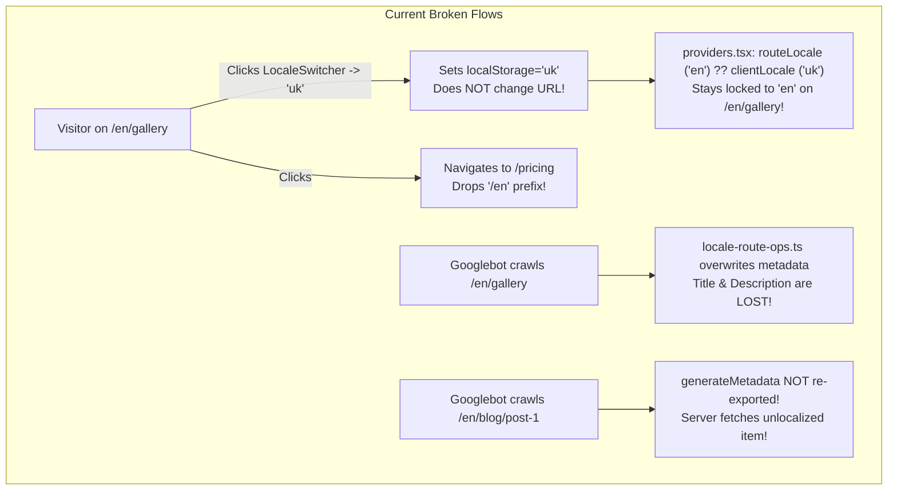
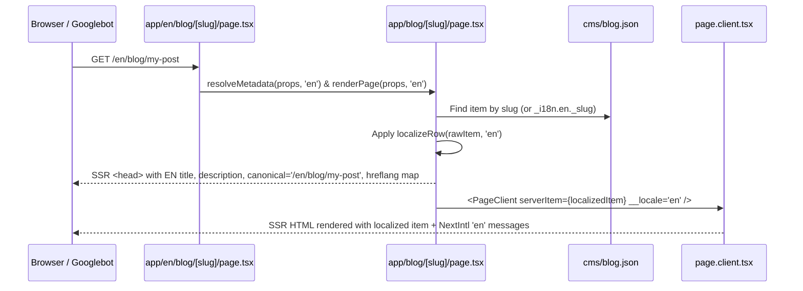
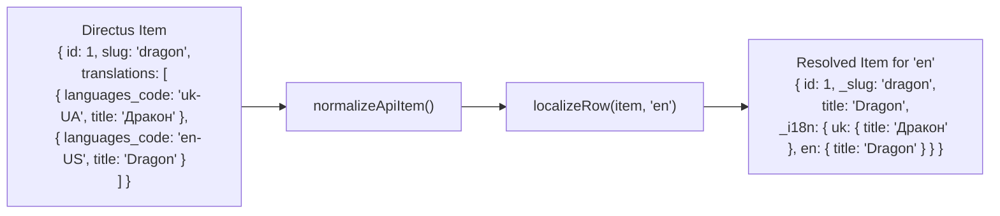

# SEO-First Multi-Locale Architecture & Step-by-Step Agent Implementation Plan

## Executive Summary

Revyme currently implements a **hybrid, partially client-side localization system** built around `i18n/config.json`, `messages/{locale}.json`, `next-intl` (`NextIntlClientProvider`), generated pointer routes (`app/{locale}/.../page.tsx`), and `@revyme/runtime` (`localizeRows`).

While the foundation is close to Next.js App Router best practices, **six critical architectural gaps** prevent published sites from having real SEO-friendly URLs (e.g., `tattoo.zp/en/gallery`), working language switching across URLs, and localized server-side CMS data/metadata for both **Built-in CMS** and **API CMS (Directus / REST)**.

This document provides:
1. **Current Architecture Audit & Root-Cause Diagnosis** (with exact file references).
2. **Target SEO & URL Routing Architecture** (`as-needed` or `always` prefix modes, true URL navigation, locale-preserving links, and SSR `<html lang>`).
3. **Static & Dynamic SEO Metadata Architecture** (bidirectional `hreflang` + `x-default`, canonical URLs, localized `title`/`description`/`openGraph`).
4. **Built-in CMS Localization Architecture** (fixing Detail page `localizeRow`, localized `generateMetadata`, localized slugs).
5. **API CMS (Directus & REST) Localization Architecture** (Directus `translations` O2M relation fetching, language code mapping, server-side + client-side normalization).
6. **Step-by-Step Implementation Plan for an AI Coding Agent** (Phases 1–6 with exact file paths, function signatures, Oracle constraints, and test verification).

---

## 1. Current Architecture Audit & Root Causes

### 1.1 How Localization Works Today
| Layer | Files | Current Mechanism |
|---|---|---|
| **Config & Messages** | [`src/code/project/locale-ops.ts`](file:///home/rost/Документи/revyme/revyme-builder-fork/src/code/project/locale-ops.ts), [`src/code/project/translation-ops.ts`](file:///home/rost/Документи/revyme/revyme-builder-fork/src/code/project/translation-ops.ts) | Stores `i18n/config.json` (`defaultLocale`, `locales[]`) and per-locale `messages/{code}.json` namespaced by page/component slug. Rewrites edited JSX text on non-default locales to `{t('nodeId')}` via [`src/code/generation/i18n-gen.ts`](file:///home/rost/Документи/revyme/revyme-builder-fork/src/code/generation/i18n-gen.ts). |
| **Provider & Active Locale** | [`src/code/project/providers-gen.ts`](file:///home/rost/Документи/revyme/revyme-builder-fork/src/code/project/providers-gen.ts) | Generates `app/providers.tsx` (`@revyme-providers v4`). Resolves `routeLocale` from `usePathname()` first segment (`NON_DEFAULT_LOCALES`), falling back to `clientLocale` (`localStorage.getItem('locale')`). Wraps tree in `<NextIntlClientProvider locale={locale} messages={MESSAGES[locale]}>`. |
| **Pointer Routes** | [`src/code/project/locale-route-ops.ts`](file:///home/rost/Документи/revyme/revyme-builder-fork/src/code/project/locale-route-ops.ts) | For each `page.client.tsx` and each non-default locale, generates `app/(Group)/{locale}/<slug>/page.tsx` (`@revyme-locale-route`) that re-exports `export { default } from '@/app/(Group)/<slug>/page'`. |
| **Language Switcher** | [`src/code/project/default-code-components/LocaleSwitcher.ts`](file:///home/rost/Документи/revyme/revyme-builder-fork/src/code/project/default-code-components/LocaleSwitcher.ts) | Default Code Component (`components/LocaleSwitcher.tsx`) that reads `/i18n/config.json` and updates `localStorage.setItem('locale', next)` + fires `CustomEvent('locale-change')`. |
| **Built-in CMS i18n** | [`src/code/generation/cms-locale-gen.ts`](file:///home/rost/Документи/revyme/revyme-builder-fork/src/code/generation/cms-locale-gen.ts), [`src/code/stores/cms-locale.ts`](file:///home/rost/Документи/revyme/revyme-builder-fork/src/code/stores/cms-locale.ts) | Stores per-item overrides in `item._i18n[locale][field]` inside `cms/<slug>.json`. Wraps `.map()` repeater sources in `localizeRows(collection, __activeLocale)`. |
| **CMS Server Pages & SEO** | [`src/code/project/cms-page-ops.ts`](file:///home/rost/Документи/revyme/revyme-builder-fork/src/code/project/cms-page-ops.ts), [`src/code/project/cms-seo.ts`](file:///home/rost/Документи/revyme/revyme-builder-fork/src/code/project/cms-seo.ts) | Generates `page.tsx` server wrappers with `generateMetadata`, `generateStaticParams`, and API CMS `fetch` orchestration. |

---

### 1.2 The 6 Critical Architectural Flaws



1. **Flaw #1: `LocaleSwitcher` Never Changes the URL (and Breaks on `/en/...` Routes)**
   - In [`LocaleSwitcher.ts`](file:///home/rost/Документи/revyme/revyme-builder-fork/src/code/project/default-code-components/LocaleSwitcher.ts#L70-L80), `handleChange(next)` only mutates `localStorage.setItem('locale', next)`.
   - In [`providers-gen.ts`](file:///home/rost/Документи/revyme/revyme-builder-fork/src/code/project/providers-gen.ts#L141-L143), `const locale = routeLocale ?? clientLocale;`.
   - **Consequence A**: If a user is on `/en/gallery`, `routeLocale` is `'en'`. Clicking `uk` or `pl` in `LocaleSwitcher` updates `clientLocale`, which is **completely ignored** because `routeLocale` takes precedence and the browser URL remains `/en/gallery`!
   - **Consequence B**: If a user is on `/gallery` (default locale) and selects `en`, the text changes in-place via `localStorage`, but the URL stays `/gallery` instead of navigating to `/en/gallery`.

2. **Flaw #2: Internal Links Drop the Active Locale Prefix**
   - All navigation links authored on the canvas (`<a href="/gallery">`) and CMS repeater cards (`href={`/blog/${item._slug}`}`) use unprefixed root paths.
   - When a user is on `/en` and clicks `<a href="/gallery">`, the browser navigates to `/gallery` (default locale) instead of `/en/gallery`.

3. **Flaw #3: Static Page SEO Metadata is Wiped Out on Localized Routes & Missing `hreflang` on Default Routes**
   - In [`locale-route-ops.ts`](file:///home/rost/Документи/revyme/revyme-builder-fork/src/code/project/locale-route-ops.ts#L72-L81), `app/en/gallery/page.tsx` exports:
     ```ts
     export const metadata = {
       alternates: { canonical: '/en/gallery', languages: { ... } }
     };
     ```
     Because `app/en/gallery/page.tsx` defines its own `export const metadata` without importing or merging `metadata` from `@/app/gallery/page`, **Next.js completely discards the page's `title`, `description`, `openGraph`, and `twitter` metadata** on `/en/gallery`!
   - Furthermore, there is no storage or codegen for translated page `title` / `description` per locale, and the default locale page (`app/gallery/page.tsx`) has **no `alternates.languages` (`hreflang`)** or `x-default` tag—violating Google's bidirectional `hreflang` requirement.

4. **Flaw #4: Dynamic `[slug]` Routes Lose `generateMetadata` on Non-Default Locales**
   - In [`locale-route-ops.ts`](file:///home/rost/Документи/revyme/revyme-builder-fork/src/code/project/locale-route-ops.ts#L63-L84), when `isDynamic` is true (`app/en/blog/[slug]/page.tsx`), `buildLocaleRouteSource` emits `export { default } from '@/app/blog/[slug]/page'` (or with `generateStaticParams`), **omitting `generateMetadata`**!
   - Even if `generateMetadata` were re-exported directly, `params` in `app/en/blog/[slug]/page.tsx` only contains `{ slug: string }` (since `en` is a static folder segment, not `[locale]`), so `generateMetadata` and `Page` in `app/blog/[slug]/page.tsx` have no idea they are executing for `'en'`!

5. **Flaw #5: Built-in CMS Detail Pages & Server Metadata Ignore Locale**
   - [`cms-locale-gen.ts`](file:///home/rost/Документи/revyme/revyme-builder-fork/src/code/generation/cms-locale-gen.ts) only wraps `.map()` repeater arrays in `localizeRows(collection, __activeLocale)`.
   - On CMS **Detail** pages (`page.client.tsx`), `const item = (serverItem ?? blog.find(...))` is **not** wrapped in `localizeRow(item, __activeLocale)`! Thus, `item.title` on a Detail page always displays the default language even when `__activeLocale` is `'en'`!
   - On the server (`page.tsx` generated by [`cms-seo.ts`](file:///home/rost/Документи/revyme/revyme-builder-fork/src/code/project/cms-seo.ts)), `generateMetadata` reads `item[field]` directly without checking `item._i18n?.[locale]?.[field]`.

6. **Flaw #6: API CMS (Directus / REST) Has Zero Localization Support**
   - Directus stores localized fields in a relational O2M `translations` array (e.g., `item.translations = [{ languages_code: 'en-US', title: '...', body: '...' }, { languages_code: 'uk-UA', title: '...', body: '...' }]`).
   - Currently:
     - [`cms-api-config.ts`](file:///home/rost/Документи/revyme/revyme-builder-fork/src/code/project/cms-api-config.ts) has no i18n configuration on `ApiCollectionConfig`.
     - Server fetches in [`cms-page-ops.ts`](file:///home/rost/Документи/revyme/revyme-builder-fork/src/code/project/cms-page-ops.ts), [`cms-seo.ts`](file:///home/rost/Документи/revyme/revyme-builder-fork/src/code/project/cms-seo.ts), and [`source-export.ts`](file:///home/rost/Документи/revyme/revyme-builder-fork/src/code/project/source-export.ts) do not request `translations.*` (or pass locale query params) and do not flatten/resolve the active locale's translation onto `item`.
     - `@revyme/runtime`'s `localizeRows` only knows about `item._i18n?.[locale]` and does not normalize Directus `item.translations[]`.

---

## 2. Target SEO & URL Routing Architecture

### 2.1 URL Prefix Strategy (`as-needed` vs `always`)
To support SEO URLs like `tattoo.zp/en/gallery` while keeping backward compatibility:
- Extend `I18nConfig` in [`src/shared/types.ts`](file:///home/rost/Документи/revyme/revyme-builder-fork/src/shared/types.ts) and [`src/code/project/locale-ops.ts`](file:///home/rost/Документи/revyme/revyme-builder-fork/src/code/project/locale-ops.ts):
  ```ts
  export type LocalePrefixMode = 'as-needed' | 'always';

  export interface I18nConfig {
    defaultLocale: string;
    /**
     * 'as-needed' (default): default locale is at `/gallery`, non-default at `/en/gallery`.
     *   (Also generates `/<defaultLocale>/gallery` redirect or alias so `/uk/gallery` never 404s).
     * 'always': every locale has an explicit prefix (`/uk/gallery`, `/en/gallery`), and `/` redirects to `/<defaultLocale>`.
     */
    localePrefix?: LocalePrefixMode;
    locales: LocaleEntry[];
  }
  ```
- **Why this matters for `tattoo.zp/en/gallery`**:
  - If Ukrainian (`uk`) is `defaultLocale` with `as-needed`: Ukrainian is `tattoo.zp/gallery` and English is `tattoo.zp/en/gallery`.
  - Even in `as-needed` mode, we can optionally emit a lightweight redirect or alias route for `defaultLocale` or handle it in middleware / `next.config` redirects so both work cleanly without duplicate content penalties (canonical always points to the canonical URL for that locale).

### 2.2 Locale-Aware Server Wrapper Contract (`page.tsx` ↔ Locale Pointer Routes)
Because Next.js App Router pointer routes live at static segment paths (`app/(Body)/en/gallery/page.tsx` and `app/(Body)/en/blog/[slug]/page.tsx`), `params` passed by Next.js does **not** include `locale`.

Instead of blind `export { default } from '@/app/...'`, we upgrade the **Server Wrapper Contract**:

1. **In Base Server Wrappers (`app/.../page.tsx`)**:
   - Export helper factories (or accept an optional `__locale` override prop/arg) alongside `default` and `generateMetadata`:
     - **Static Page (`app/gallery/page.tsx`)**:
       ```tsx
       import PageClient from './page.client';
       import { buildLocalizedPageMetadata } from '@/i18n/seo';

       export const metadata = buildLocalizedPageMetadata('gallery', '/gallery', 'uk', {
         title: 'Галерея тату',
         description: 'Наші роботи',
       });

       export default function Page() {
         return <PageClient />;
       }
       ```
     - **CMS Index & Detail Pages (`app/blog/page.tsx`, `app/blog/[slug]/page.tsx`)**:
       Export `renderPage(props, localeOverride?: string)` and `resolveMetadata(props, localeOverride?: string)` in addition to `default` and `generateMetadata`:
       ```tsx
       export async function resolveMetadata(
         { params }: { params: Promise<{ slug: string }> },
         locale = 'uk',
       ): Promise<Metadata> { ... }

       export async function generateMetadata(props: { params: Promise<{ slug: string }> }): Promise<Metadata> {
         return resolveMetadata(props, 'uk');
       }

       export async function renderPage(
         { params }: { params: Promise<{ slug: string }> },
         locale = 'uk',
       ) { ... }

       export default async function Page(props: { params: Promise<{ slug: string }> }) {
         return renderPage(props, 'uk');
       }
       ```

2. **In Generated Locale Pointer Routes (`app/en/blog/[slug]/page.tsx`)** ([`locale-route-ops.ts`](file:///home/rost/Документи/revyme/revyme-builder-fork/src/code/project/locale-route-ops.ts)):
   - Instead of dropping `generateMetadata` or wiping out `metadata`, the generated pointer route delegates with the explicit `locale` literal (`'en'`):
     ```tsx
     /** @revyme-locale-route en — GENERATED route for /en/blog/[slug]. Do not edit. */
     import * as OriginPage from '@/app/blog/[slug]/page';
     import { buildLocalizedPageMetadata } from '@/i18n/seo';

     export const generateMetadata = OriginPage.resolveMetadata
       ? (props: any) => OriginPage.resolveMetadata(props, 'en')
       : async () => buildLocalizedPageMetadata('blog/[slug]', '/blog/[slug]', 'en', (OriginPage as any).metadata);

     export default function LocalizedPage(props: any) {
       if (typeof OriginPage.renderPage === 'function') {
         return OriginPage.renderPage(props, 'en');
       }
       const DefaultPage = OriginPage.default as any;
       return <DefaultPage {...props} __locale="en" />;
     }
     ```
   - **Why this design is rock-solid**:
     - Works identically for static pages, CMS Index pages, and CMS `[slug]` Detail pages!
     - Preserves 100% of Revyme's existing editor assumptions (Pages panel still only lists `page.client.tsx`, canvas still edits `page.client.tsx`).
     - Requires **no `[locale]` folder restructuring** that would break existing projects or route groups.

---

## 3. True URL-Driven `LocaleSwitcher` & Locale-Preserving Navigation

### 3.1 Rebuilding `LocaleSwitcher.tsx` for Real URL Navigation
In [`src/code/project/default-code-components/LocaleSwitcher.ts`](file:///home/rost/Документи/revyme/revyme-builder-fork/src/code/project/default-code-components/LocaleSwitcher.ts):

- **In the Canvas Iframe (`window.__REVYME_CANVAS__` or preview iframe without Next router)**:
  - Keep existing `localStorage.setItem('locale', next)` + `window.dispatchEvent(new CustomEvent('locale-change', { detail: { locale: next } }))` so switching languages inside the builder canvas works instantaneously without navigating the iframe away.
- **In the Live Next.js Site / Preview**:
  - Use `usePathname()`, `useSearchParams()`, and `useRouter()` from `next/navigation`.
  - Compute the target localized URL:
    1. Strip any current locale prefix (`/en/gallery` → `/gallery`, `/en` → `/`).
    2. If `next === config.defaultLocale` (and `localePrefix !== 'always'`), target path is `barePath` (`/gallery` or `/`).
    3. Otherwise, target path is `barePath === '/' ? `/${next}` : `/${next}${barePath}``.
    4. Preserve query string (`searchParams.toString()`) and hash (`window.location.hash`).
    5. Persist preference in `localStorage.setItem('locale', next)` AND `document.cookie = `NEXT_LOCALE=${next}; path=/; max-age=31536000; SameSite=Lax``.
    6. Call `router.push(targetUrl)`!

### 3.2 Automatic Locale Prefix Preservation on Internal Links
In [`src/code/project/providers-gen.ts`](file:///home/rost/Документи/revyme/revyme-builder-fork/src/code/project/providers-gen.ts):

1. **Click Interceptor (`revymeNavClick`)**:
   - `providers.tsx` already attaches a capture-phase document click listener (`revymeNavClick`) for internal `<a>` links!
   - Enhance `revymeNavClick` so that when `locale !== DEFAULT_LOCALE` (or `localePrefix === 'always'`), any internal link `href` starting with `/` (that does not already start with `/${locale}/`, `/api/`, `/_next/`, or point to a static asset with an extension) is automatically rewritten to `/${locale}${href === '/' ? '' : href}` and navigated via `router.push()` (or `a.href` rewrite before Next.js `<Link>` handles it).
2. **DOM `href` Hydration for SEO Crawlers**:
   - Search engines (`Googlebot`) read `<a href="...">` attributes directly from SSR HTML rather than clicking links.
   - To ensure SSR HTML on `/en/gallery` contains `<a href="/en/about">` instead of `<a href="/about">`:
     - Export a lightweight helper `localizeHref(href: string, locale: string, defaultLocale: string)` from `@revyme/runtime` (and inline in `providers.tsx`).
     - In [`cms-page-ops.ts`](file:///home/rost/Документи/revyme/revyme-builder-fork/src/code/project/cms-page-ops.ts) / [`map-gen.ts`](file:///home/rost/Документи/revyme/revyme-builder-fork/src/code/generation/map-gen.ts), update `cmsNavHrefExpr` so CMS detail card links include the active locale prefix when on a non-default locale:
       ```tsx
       href={`${__activeLocale && __activeLocale !== 'uk' ? '/' + __activeLocale : ''}/${collectionSlug}/${item._slug}`}
       ```

---

## 4. Static & Dynamic SEO Metadata Architecture

### 4.1 Generated `i18n/seo.ts` Helper Module
When `syncLocaleArtifacts` runs in [`src/code/project/locale-ops.ts`](file:///home/rost/Документи/revyme/revyme-builder-fork/src/code/project/locale-ops.ts), generate a small, pure server helper at `i18n/seo.ts`:

- **Responsibilities of `i18n/seo.ts`**:
  1. Imports `i18n/config.json` and all `messages/{locale}.json`.
  2. Provides `buildAlternates(urlPath: string, activeLocale: string)`:
     - Computes `canonical`: `activeLocale === defaultLocale ? urlPath : (urlPath === '/' ? `/${activeLocale}` : `/${activeLocale}${urlPath}`)`.
     - Computes `languages`: maps every configured locale in `i18n/config.json` to its URL, **plus `'x-default': urlPath`**.
  3. Provides `buildLocalizedPageMetadata(pageNamespace: string, urlPath: string, activeLocale: string, baseMetadata?: Metadata): Metadata`:
     - Reads optional localized SEO overrides from `messages/{activeLocale}.json` under `messages[pageNamespace]?.['_seo']` (e.g. `{ "_seo": { "title": "Tattoo Gallery", "description": "Our best works", "ogTitle": "...", "ogDescription": "..." } }`).
     - Merges `baseMetadata` (from `app/gallery/page.tsx`) + localized `_seo` strings + `openGraph` (`locale: activeLocale`) + `alternates: buildAlternates(urlPath, activeLocale)`.

### 4.2 Default Locale Pages Also Get Bidirectional `hreflang`
- In [`src/cloud/settings/PagesSeoSection.tsx`](file:///home/rost/Документи/revyme/revyme-builder-fork/src/cloud/settings/PagesSeoSection.tsx) and [`src/code/project/locale-route-ops.ts`](file:///home/rost/Документи/revyme/revyme-builder-fork/src/code/project/locale-route-ops.ts):
  - Ensure default-locale static pages (`app/gallery/page.tsx`) also include `alternates` (or call `buildLocalizedPageMetadata`) when multiple locales exist, so Google sees full bidirectional `hreflang` tags on both `/gallery` and `/en/gallery`.
  - In the Page SEO settings UI (`PagesSeoSection.tsx`), when a non-default locale is active in the editor (or via a locale selector tab in SEO settings), allow editing the localized `title` and `description` stored in `messages/{locale}.json` under `[pageNamespace]._seo`.

---

## 5. Built-in CMS Localization Architecture



### 5.1 Fixing Built-in CMS Detail Pages (`localizeRow`)
1. **Runtime Helper (`@revyme/runtime` & [`src/code/stores/cms-locale.ts`](file:///home/rost/Документи/revyme/revyme-builder-fork/src/code/stores/cms-locale.ts))**:
   - Export `localizeRow<T>(row: T | null | undefined, locale: string | null | undefined): T | null | undefined` alongside `localizeRows`.
   - `localizeRow` merges `row._i18n?.[locale]` (and Directus `row.translations` — see Section 6) onto a shallow clone of `row` for non-empty values.
2. **Codegen in [`src/code/generation/cms-locale-gen.ts`](file:///home/rost/Документи/revyme/revyme-builder-fork/src/code/generation/cms-locale-gen.ts) & [`src/code/project/cms-page-ops.ts`](file:///home/rost/Документи/revyme/revyme-builder-fork/src/code/project/cms-page-ops.ts)**:
   - Update `ensureLocalizeRowsInCode` in `cms-locale-gen.ts` (and `buildCmsDetailClientCode` in `cms-page-ops.ts`) so that on CMS Detail pages:
     ```tsx
     const rawItem = serverItem ?? blog.find((r: any) => String(r._slug ?? r.slug ?? r.id) === slug) ?? blog[0];
     const item = localizeRow(rawItem, __activeLocale);
     ```
   - Also support localized slug matching in `.find()`:
     ```tsx
     (r: any) => String(r._i18n?.[__activeLocale]?._slug ?? r._slug ?? r.slug ?? r.id) === slug || String(r._slug ?? r.slug ?? r.id) === slug
     ```

### 5.2 Server-Side `generateMetadata` & `renderPage` for Built-in CMS (`cms-seo.ts`)
In [`src/code/project/cms-seo.ts`](file:///home/rost/Документи/revyme/revyme-builder-fork/src/code/project/cms-seo.ts) (`buildCmsDetailServerWrapper`):
- Accept `locale` in `resolveMetadata({ params }, locale = defaultLocale)` and `renderPage({ params }, locale = defaultLocale)`:
  1. Find matching item in `<collection>.json` (matching either `item._i18n?.[locale]?._slug` or `item._slug`).
  2. Localize the item on the server before reading SEO fields:
     ```ts
     const rawItem = (collectionData as any[]).find(...);
     const item = rawItem && locale && rawItem._i18n?.[locale]
       ? { ...rawItem, ...Object.fromEntries(Object.entries(rawItem._i18n[locale]).filter(([, v]) => v !== '' && v != null)) }
       : rawItem;
     ```
  3. Build `alternates`:
     - `canonical`: `locale === defaultLocale ? `/${collectionSlug}/${slug}` : `/${locale}/${collectionSlug}/${slug}``
     - `languages`: map every locale `l.code` to its URL (using `rawItem._i18n?.[l.code]?._slug || rawItem._slug`), plus `'x-default'`.
  4. Return localized `title`, `description`, `openGraph`, and `alternates`.

---

## 6. API CMS (Directus & External REST) Localization Architecture

### 6.1 How Directus Stores Translations
In Directus, translatable collections use a standard **Translations O2M (One-to-Many) junction table**:
- Collection `articles` has static fields (`id`, `slug`, `status`, `date_created`, `cover_image`) and a relational field `translations`.
- When queried with `?fields=*,translations.*`, Directus returns:
  ```json
  {
    "id": 42,
    "slug": "irezumi-dragon",
    "cover_image": "uuid-...",
    "translations": [
      {
        "id": 1,
        "articles_id": 42,
        "languages_code": "uk-UA",
        "title": "Японський дракон Іредзумі",
        "description": "Історія та значення..."
      },
      {
        "id": 2,
        "articles_id": 42,
        "languages_code": "en-US",
        "title": "Japanese Irezumi Dragon",
        "description": "History and meaning..."
      }
    ]
  }
  ```
- Alternatively, some REST APIs or custom Directus endpoints accept a query parameter like `?lang=en` or `?locale=en`.

### 6.2 Extending `ApiCollectionConfig` (`src/code/project/cms-api-config.ts`)
Add an optional `i18n` configuration block to `ApiCollectionConfig` in [`src/code/project/cms-api-config.ts`](file:///home/rost/Документи/revyme/revyme-builder-fork/src/code/project/cms-api-config.ts):

```ts
export type ApiI18nStrategy = 'directus_translations' | 'query_param' | 'none';

export interface ApiCollectionI18nConfig {
  /**
   * 'directus_translations' (default for provider === 'directus'):
   *   Fetches `translations.*` and flattens matching entry from `item[translationsField]`
   *   where `entry[languageField]` matches active locale (exact or prefix match, e.g. 'en' matches 'en-US').
   * 'query_param':
   *   Appends `?{queryParam}={mappedLocale}` to the upstream API request.
   * 'none':
   *   No localization handling.
   */
  strategy: ApiI18nStrategy;
  /** Field holding the translations array in Directus. Default: "translations" */
  translationsField?: string;
  /** Field inside each translation object holding the language code. Default: "languages_code" */
  languageField?: string;
  /** Query parameter name when strategy === 'query_param'. Default: "locale" */
  queryParam?: string;
  /** Optional explicit mapping from Revyme locale code to API/Directus code, e.g. { "en": "en-US", "uk": "uk-UA" } */
  localeMap?: Record<string, string>;
}
```

### 6.3 Automatic Directus `fields` Enrichment & Universal Normalization
1. **Automatic `fields=*,translations.*` for Directus**:
   - In [`buildApiRequestUrl`](file:///home/rost/Документи/revyme/revyme-builder-fork/src/code/project/cms-api-config.ts#L138-L187) (and server fetch generators in `cms-page-ops.ts`, `cms-seo.ts`, `source-export.ts`):
   - When `apiConfig.provider === 'directus'` and `apiConfig.i18n?.strategy !== 'none'`:
     - If `fields` param is not set, default to `*,translations.*` (or if `fields` is `*`, append `,translations.*` so Directus always includes the translations array unless `fields` already contains `*.*` or `translations`).
   - When `apiConfig.i18n?.strategy === 'query_param'` and a `locale` is provided:
     - Set query param `[apiConfig.i18n.queryParam || 'locale'] = apiConfig.i18n.localeMap?.[locale] || locale`.

2. **Universal Translation Flattening in `localizeRow` / `localizeRows` & Server Fetch**:
   - Enhance `localizeRow(item, locale, i18nConfig?)` (in both `@revyme/runtime` and [`src/code/stores/cms-locale.ts`](file:///home/rost/Документи/revyme/revyme-builder-fork/src/code/stores/cms-locale.ts), and emitted into server wrappers in `cms-page-ops.ts` / `cms-seo.ts`):
   - **Step A**: Check `item._i18n?.[locale]` (Built-in CMS format).
   - **Step B**: Check `item.translations` (or `item[translationsField]`) if it is an `Array`:
     - Match translation object where `t.languages_code` (or `t.language` / `t.locale`):
       1. Exactly equals `localeMap?.[locale] ?? locale` (case-insensitive, e.g. `'en-US' === 'en-US'`), OR
       2. Starts with `${locale.toLowerCase()}-` or `${locale.toLowerCase()}_` (so Revyme locale `'en'` automatically matches Directus `'en-US'` or `'en-GB'`, and `'uk'` automatically matches `'uk-UA'`!), OR
       3. Its 2-letter primary subtag equals `locale.toLowerCase()`.
     - When matched, merge all non-metadata keys from the translation entry (`title`, `description`, `content`, etc. — excluding `id`, `languages_code`, and foreign key `*_id`) onto the cloned `item`!
     - Also populate `item._i18n` for all entries in `item.translations` during `normalizeApiItem` so client-side locale switching and server-side `hreflang` slug resolution work with zero extra network requests!



---

## 7. Step-by-Step Execution Plan for an AI Coding Agent

> [!IMPORTANT]
> **Agent Instructions**: Execute the following phases in order. Respect all 5 architectural invariants in `AGENTS.md`. Run `npx tsc --noEmit` and `npx vitest run` after each phase.

---

### Phase 1: Schema & Config Foundation (`I18nConfig`, `ApiCollectionConfig`, `i18n/seo.ts`)

#### Step 1.1: Extend `I18nConfig` and `ApiCollectionConfig` Types
- **Files to modify**:
  - [`src/shared/types.ts`](file:///home/rost/Документи/revyme/revyme-builder-fork/src/shared/types.ts)
  - [`src/code/project/cms-api-config.ts`](file:///home/rost/Документи/revyme/revyme-builder-fork/src/code/project/cms-api-config.ts)
- **Changes**:
  1. In `src/shared/types.ts`, add `localePrefix?: 'as-needed' | 'always'` to `I18nConfig`.
  2. In `src/code/project/cms-api-config.ts`, define `ApiI18nStrategy` (`'directus_translations' | 'query_param' | 'none'`) and `ApiCollectionI18nConfig`, and add `i18n?: ApiCollectionI18nConfig` to `ApiCollectionConfig`.
  3. Update `buildApiRequestUrl(apiConfig, queryParams, locale?)` in `src/code/project/cms-api-config.ts`:
     - If `apiConfig.provider === 'directus'` and `apiConfig.i18n?.strategy !== 'none'`, ensure `fields` includes `translations.*` (if `fields` is unset, set `*,translations.*`; if `fields` is set and doesn't contain `*.*` or `translations`, append `,translations.*`).
     - If `apiConfig.i18n?.strategy === 'query_param'` and `locale` is provided, set the configured `queryParam` (default `'locale'`) to `apiConfig.i18n.localeMap?.[locale] ?? locale`.

#### Step 1.2: Generate `i18n/seo.ts` in `syncLocaleArtifacts`
- **Files to modify**:
  - [`src/code/project/locale-ops.ts`](file:///home/rost/Документи/revyme/revyme-builder-fork/src/code/project/locale-ops.ts)
- **Changes**:
  1. Add a generator function `buildI18nSeoHelperSource(config: I18nConfig): string` that outputs `i18n/seo.ts`.
  2. `i18n/seo.ts` must export:
     - `buildLocaleAlternates(urlPath: string, activeLocale?: string)` returning `{ canonical: string, languages: Record<string, string> }` (including `'x-default'`).
     - `buildLocalizedPageMetadata(pageNamespace: string, urlPath: string, activeLocale: string, baseMetadata?: Record<string, any>)` which reads `messages/{activeLocale}.json` → `[pageNamespace]?._seo` (`title`, `description`, `ogTitle`, `ogDescription`, `ogImage`), merges with `baseMetadata`, and attaches `alternates: buildLocaleAlternates(urlPath, activeLocale)` and `openGraph.locale = activeLocale`.
  3. Call this generator inside `syncLocaleArtifacts(config)` so `i18n/seo.ts` is kept in sync whenever locales or messages change (and removed if `locales.length <= 1`).

---

### Phase 2: Upgrading Locale Pointer Routes & Static Page SEO (`locale-route-ops.ts`)

#### Step 2.1: Upgrade `buildLocaleRouteSource` to Preserve & Localize Metadata + Support Dynamic Routes
- **Files to modify**:
  - [`src/code/project/locale-route-ops.ts`](file:///home/rost/Документи/revyme/revyme-builder-fork/src/code/project/locale-route-ops.ts)
  - [`src/code/project/translation-ops.ts`](file:///home/rost/Документи/revyme/revyme-builder-fork/src/code/project/translation-ops.ts)
- **Changes**:
  1. In [`src/code/project/locale-route-ops.ts`](file:///home/rost/Документи/revyme/revyme-builder-fork/src/code/project/locale-route-ops.ts), update `buildLocaleRouteSource(pageClientPath, locale, config, options)`:
     - Derive `namespace = filePathToNamespace(pageClientPath)`.
     - For **static pages** (`!isDynamic`):
       ```tsx
       /** @revyme-locale-route ${locale} — GENERATED route for ${localeUrl}. Do not edit. */
       import * as OriginPage from '@/${pageDir}/page';
       import { buildLocalizedPageMetadata } from '@/i18n/seo';

       export const metadata = buildLocalizedPageMetadata(
         '${namespace}',
         '${url}',
         '${locale}',
         (OriginPage as any).metadata,
       );

       export default function LocalizedPage(props: any) {
         if (typeof (OriginPage as any).renderPage === 'function') {
           return (OriginPage as any).renderPage(props, '${locale}');
         }
         const DefaultPage = OriginPage.default as any;
         return <DefaultPage {...props} />;
       }
       ```
     - For **dynamic `[slug]` pages** (`isDynamic`):
       ```tsx
       /** @revyme-locale-route ${locale} — GENERATED route for ${localeUrl}. Do not edit. */
       import * as OriginPage from '@/${pageDir}/page';

       export async function generateMetadata(props: any) {
         if (typeof (OriginPage as any).resolveMetadata === 'function') {
           return (OriginPage as any).resolveMetadata(props, '${locale}');
         }
         if (typeof (OriginPage as any).generateMetadata === 'function') {
           return (OriginPage as any).generateMetadata(props);
         }
         return {};
       }

       ${options?.includeStaticParams ? `export { generateStaticParams } from '@/${pageDir}/page';\n` : ''}
       export default function LocalizedPage(props: any) {
         if (typeof (OriginPage as any).renderPage === 'function') {
           return (OriginPage as any).renderPage(props, '${locale}');
         }
         const DefaultPage = OriginPage.default as any;
         return <DefaultPage {...props} />;
       }
       ```
  2. In [`src/code/project/translation-ops.ts`](file:///home/rost/Документи/revyme/revyme-builder-fork/src/code/project/translation-ops.ts), add helper functions `getPageSeoTranslation(pageNamespace, locale)` and `setPageSeoTranslation(pageNamespace, locale, seoFields)` that read/write `messages/{locale}.json` under `[pageNamespace]._seo`.

---

### Phase 3: True URL Navigation in `LocaleSwitcher` & `providers.tsx`

#### Step 3.1: Upgrade `LocaleSwitcher.ts` to Navigate Between Locale URLs
- **Files to modify**:
  - [`src/code/project/default-code-components/LocaleSwitcher.ts`](file:///home/rost/Документи/revyme/revyme-builder-fork/src/code/project/default-code-components/LocaleSwitcher.ts)
- **Changes**:
  1. Import `usePathname, useRouter` from `'next/navigation'`.
  2. Detect whether `LocaleSwitcher` is running inside the builder's edit canvas (`const isCanvas = typeof window !== 'undefined' && Boolean((window as any).__REVYME_CANVAS__ || window.parent !== window && window.location.pathname.startsWith('/_canvas'))`).
  3. Resolve initial active `locale`:
     - First check if `pathname` starts with a configured non-default locale segment (`/${code}/` or `/${code}`).
     - Otherwise fall back to `localStorage.getItem('locale')` or `config.defaultLocale`.
  4. In `handleChange(next: string)`:
     - Save `localStorage.setItem('locale', next)` and set cookie `NEXT_LOCALE=${next}; path=/; max-age=31536000; SameSite=Lax`.
     - Dispatch `window.dispatchEvent(new CustomEvent('locale-change', { detail: { locale: next } }))`.
     - If `!isCanvas && pathname`:
       - Strip any existing locale prefix from `pathname` to get `barePath` (e.g. `/en/gallery` → `/gallery`, `/en` → `/`).
       - Compute `targetPath = (next === config.defaultLocale && config.localePrefix !== 'always') ? barePath : (barePath === '/' ? `/${next}` : `/${next}${barePath}`)`.
       - Preserve `window.location.search` and `window.location.hash`.
       - Call `router.push(targetPath + search + hash)`.

#### Step 3.2: Upgrade `providers-gen.ts` (`@revyme-providers v5`) for Link Localization & Route Sync
- **Files to modify**:
  - [`src/code/project/providers-gen.ts`](file:///home/rost/Документи/revyme/revyme-builder-fork/src/code/project/providers-gen.ts)
- **Changes**:
  1. Bump `PROVIDERS_VERSION_MARKER` to `'@revyme-providers v5'`.
  2. In `providers.tsx`:
     - Export `function localizeHref(href: string, locale: string): string` which prefixes internal paths (`/gallery` → `/en/gallery`) when `locale !== DEFAULT_LOCALE` (ignoring paths already prefixed with a locale, `/api/...`, `/_next/...`, `#...`, or asset files with extensions like `.pdf`, `.png`).
     - In `revymeNavClick(e: MouseEvent)`:
       - When an `<a>` tag has an internal `href` starting with `/` and `locale !== DEFAULT_LOCALE`, rewrite the target href via `localizeHref(href, locale)` so clicking `<a href="/gallery">` while on `/en` navigates to `/en/gallery`!
     - Add a `MutationObserver` or `useEffect` on `[pathname, locale]` in `Providers` that updates internal `<a href="/...">` attributes inside the DOM (`data-orig-href` preserved) when `locale !== DEFAULT_LOCALE`, so browser hover previews, middle-click "Open in new tab", and client crawlers see `/en/gallery`.
     - Ensure `const locale = routeLocale ?? DEFAULT_LOCALE;` on real route pages so that navigating from `/en/gallery` to `/gallery` properly switches the active locale back to `DEFAULT_LOCALE` (`uk`), while still allowing `clientLocale` override only when inside the canvas preview.

---

### Phase 4: Universal `localizeRow` / `localizeRows` (Built-in `_i18n` + Directus `translations[]`)

#### Step 4.1: Upgrade `cms-locale.ts` and `@revyme/runtime`
- **Files to modify**:
  - [`src/code/stores/cms-locale.ts`](file:///home/rost/Документи/revyme/revyme-builder-fork/src/code/stores/cms-locale.ts)
  - [`packages/runtime/src/cms-locale.ts`](file:///home/rost/Документи/revyme/revyme-builder-fork/packages/runtime/src/cms-locale.ts) (and re-export `localizeRow` from `packages/runtime/src/index.ts`)
- **Changes**:
  1. Implement `matchLocaleCode(candidate: string, targetLocale: string): number`:
     - Returns `3` for exact case-insensitive match (`'en-US' === 'en-us'`, `'uk' === 'uk'`).
     - Returns `2` if `candidate.toLowerCase()` starts with `${targetLocale.toLowerCase()}-` or `${targetLocale.toLowerCase()}_` (e.g. candidate `'en-US'` matches target `'en'`; candidate `'uk-UA'` matches target `'uk'`).
     - Returns `1` if primary 2-letter subtags match (`candidate.split(/[-_]/)[0] === targetLocale.split(/[-_]/)[0]`).
     - Returns `0` otherwise.
  2. Implement `extractDirectusTranslation(row: Record<string, any>, locale: string, translationsField = 'translations', languageField = 'languages_code'): Record<string, any> | null`:
     - Inspects `row[translationsField]`. If it is a non-empty array, finds the entry with the highest `matchLocaleCode(entry[languageField] ?? entry.language ?? entry.locale, locale)`.
     - Filters out relational metadata keys (`id`, `languages_code`, `languages_id`, `language`, and any key ending in `_id` whose value equals `row.id`).
     - Returns the clean translated fields object.
  3. Implement and export `localizeRow<T extends Record<string, any>>(row: T | null | undefined, locale: string | null | undefined): T`:
     - If `!row || !locale`, return `row`.
     - Merge both Directus translation fields (`extractDirectusTranslation(row, locale)`) AND Built-in CMS overrides (`row._i18n?.[locale]`) onto a shallow copy of `row` (ignoring `''`, `null`, `undefined` values so untranslated fields fall back to default locale).
  4. Update `localizeRows(rows, locale)` to map `localizeRow(r, locale)` over `rows`.

#### Step 4.2: Wire `localizeRow` into CMS Detail Pages & localized Links
- **Files to modify**:
  - [`src/code/generation/cms-locale-gen.ts`](file:///home/rost/Документи/revyme/revyme-builder-fork/src/code/generation/cms-locale-gen.ts)
  - [`src/code/project/cms-page-ops.ts`](file:///home/rost/Документи/revyme/revyme-builder-fork/src/code/project/cms-page-ops.ts)
  - [`src/code/generation/map-gen.ts`](file:///home/rost/Документи/revyme/revyme-builder-fork/src/code/generation/map-gen.ts)
- **Changes**:
  1. In `cms-locale-gen.ts` (`ensureLocalizeRowsInCode`), detect CMS Detail page `const item = ...` declarations and wrap them with `localizeRow(..., __activeLocale)` (importing `localizeRow` from `@revyme/runtime`).
  2. In `cms-page-ops.ts` (`buildCmsDetailClientCode`), emit `localizeRow` around `item` resolution and support matching `_i18n?.[__activeLocale]?._slug` in `.find()`.

---

### Phase 5: Locale-Aware Server Wrappers for CMS Index & Detail Pages (Built-in + Directus API)

#### Step 5.1: Upgrade `buildCmsDetailServerWrapper` in `src/code/project/cms-seo.ts`
- **Files to modify**:
  - [`src/code/project/cms-seo.ts`](file:///home/rost/Документи/revyme/revyme-builder-fork/src/code/project/cms-seo.ts)
- **Changes**:
  1. Emit a self-contained server helper `localizeServerItem(row: any, locale: string)` inside generated `page.tsx` wrappers that handles both `row._i18n?.[locale]` (Built-in CMS) and `row.translations` array (Directus O2M translations).
  2. In `normalizeApiItem(raw, slugField, idField)`, also preserve `translations` (and populate `_i18n` from `raw.translations` if present).
  3. Generate `export async function resolveMetadata({ params }: { params: Promise<{ slug: string }> }, locale = '${defaultLocale}'): Promise<Metadata>` and `export async function generateMetadata(props: { params: Promise<{ slug: string }> }): Promise<Metadata> { return resolveMetadata(props, '${defaultLocale}'); }`:
     - Resolves `rawItem` (from local JSON or API fetch).
     - Applies `const item = localizeServerItem(rawItem, locale);`.
     - Computes `title`, `description`, `ogImage` from `item` (withlocalized fallback).
     - Computes `alternates` (`canonical` and `languages` map across all configured locales in `i18n/config.json`, plus `'x-default'`).
  4. Generate `export async function renderPage({ params }: { params: Promise<{ slug: string }> }, locale = '${defaultLocale}')` and `export default async function Page(props: { params: Promise<{ slug: string }> }) { return renderPage(props, '${defaultLocale}'); }`:
     - Localizes `serverItem = localizeServerItem(rawItem, locale)` on the server before passing `<PageClient serverItem={serverItem} />` so SSR HTML immediately renders the translated Directus/CMS fields!

#### Step 5.2: Upgrade `buildCmsIndexServerWrapper` & `orchestrateServerFetchForQueries` in `src/code/project/cms-page-ops.ts`
- **Files to modify**:
  - [`src/code/project/cms-page-ops.ts`](file:///home/rost/Документи/revyme/revyme-builder-fork/src/code/project/cms-page-ops.ts)
  - [`src/code/project/source-export.ts`](file:///home/rost/Документи/revyme/revyme-builder-fork/src/code/project/source-export.ts)
- **Changes**:
  1. In `buildCmsIndexServerWrapper` (`cms-page-ops.ts`):
     - Export `renderPage(props?: any, locale = '${defaultLocale}')` and `default` function `Page(props: any) { return renderPage(props, '${defaultLocale}'); }`.
     - In `normalizeApiItem`, preserve `translations` and apply `localizeServerItem(item, locale)` so SSR repeater items are already localized for the route's `locale`, while retaining `translations` / `_i18n` so `localizeRows(collection, __activeLocale)` in `page.client.tsx` also works on hydration.
     - Export localized `metadata` via `buildLocalizedPageMetadata` when multiple locales exist.
  2. In `orchestrateServerFetchForQueries` (`cms-page-ops.ts`) and `buildCmsQueryRouteHandler` (`source-export.ts`):
     - Ensure Directus collections automatically request `fields=*,translations.*` (via `buildApiRequestUrl`).
     - In `/api/cms/query/route.ts` (`buildCmsQueryRouteHandler`), accept optional `locale` in the POST body (`{ collection, params, locale }`) and pass it to `buildApiRequestUrl(apiConfig, mergedParams, locale)`.

---

### Phase 6: Oracle Rules & Verification Suite

#### Step 6.1: Check Oracle Compatibility (`src/code/oracle/`)
- **Files to check**:
  - [`src/code/oracle/check-file.ts`](file:///home/rost/Документи/revyme/revyme-builder-fork/src/code/oracle/check-file.ts)
  - [`src/code/parsing/parser.ts`](file:///home/rost/Документи/revyme/revyme-builder-fork/src/code/parsing/parser.ts)
- **Verification**:
  - Ensure `localizeRow(item, __activeLocale)` in `page.client.tsx` is recognized transparently by the parser and scoped expression evaluator ([`src/code/generation/scoped-expr.ts`](file:///home/rost/Документи/revyme/revyme-builder-fork/src/code/generation/scoped-expr.ts)), just like `localizeRows(collection, __activeLocale)`.
  - Ensure `isLocaleRouteFile` skips Oracle page-structure checks on generated `@revyme-locale-route` files.

#### Step 6.2: Automated Unit & Integration Tests
- **Test files to add/update**:
  1. `src/code/project/__tests__/locale-route-ops.test.ts` — Verify static and dynamic `[slug]` locale pointer routes export `metadata` / `generateMetadata` and delegate `renderPage(props, locale)` and `resolveMetadata(props, locale)`.
  2. `src/code/stores/__tests__/cms-locale.test.ts` — Verify `localizeRow` and `localizeRows` with:
     - Built-in CMS `_i18n` objects.
     - Directus `translations` arrays with exact (`en` → `en`) and regional (`en` → `en-US`, `uk` → `uk-UA`) language codes.
     - Empty string fallback to base item fields.
  3. `src/code/project/cms-seo.test.ts` — Verify `buildCmsDetailServerWrapper` emits `resolveMetadata`, `renderPage`, bidirectional `hreflang` alternates, and `localizeServerItem`.
  4. `src/code/project/__tests__/providers-gen.test.ts` — Verify `@revyme-providers v5` link localization (`localizeHref`) and `routeLocale` resolution.
- **Commands to run**:
  ```bash
  npx tsc --noEmit
  npx vitest run src/code/project/__tests__/locale-route-ops.test.ts src/code/stores/__tests__/cms-locale.test.ts src/code/project/cms-seo.test.ts
  ```
