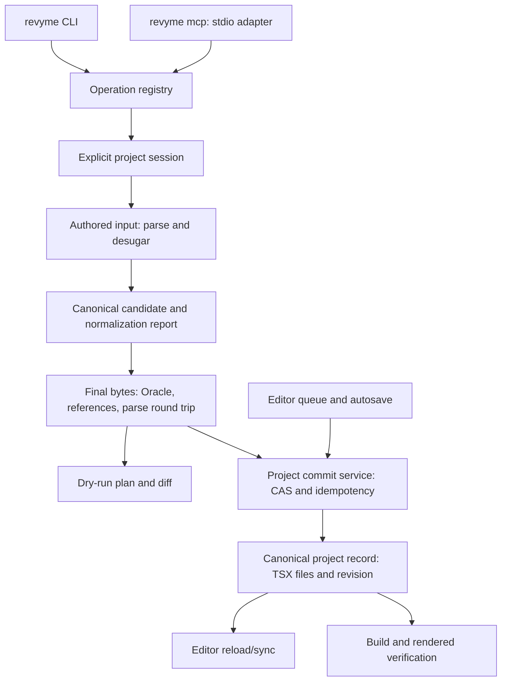

> **Статус: історична архітектурна довідка.** Актуальний scope повного покриття Revyme, 25 tasks і release gates визначає `2026-10-21-revyme-cli-mcp-v2.md` та `../specs/2026-10-21-revyme-mcp-full-coverage.md`. Цей попередній документ не є поточним implementation plan.

# Revyme CLI та MCP v2 — Implementation Plan

> **For agentic workers:** REQUIRED SUB-SKILL: Use superpowers:executing-plans to implement this plan task-by-task. Steps use checkbox (`- [ ]`) syntax for tracking. Реалізація цього плану не починалася; поточне завдання — дослідження та план.

**Goal:** Створити headless CLI та MCP v2, через які агент будує GUI-editable сайти Revyme з явним scope, перевіреним TSX та підтвердженим збереженням.

**Architecture:** Новий automation core приймає природний authored JSX або декларативне дерево, компілює їх ingestion/desugaring шаром у канонічний Revyme TSX, перевіряє фінальні файли й атомарно записує їх за expected revision. CLI і MCP — тонкі adapters одного operation registry. Редактор використовує той самий серверний контроль версії; browser connection потрібен лише для спеціальних live-observation можливостей.

**Tech Stack:** TypeScript, Node.js >=22 відповідно до чинного `engines` Revyme, наявні Babel/Zod/MCP SDK, Node `util.parseArgs`, Vitest, Playwright. Нові parser, React runtime, scene graph або зовнішня черга не потрібні. Використати наявний build tooling для package entrypoints; не додавати бібліотеку лише для парсингу CLI flags.

**Spec:** `../research/2026-10-21-webstudio-revyme-mcp-audit.md`, розділи «Архітектурний brief» та «Причини та докази». Рекомендований варіант: новий automation core, збереження TSX формату.

## Global Constraints

- TSX залишається джерелом істини; scene graph не додається.
- Canvas DOM не є write API.
- Порожній style string зберігає значення delete.
- Breakpoints беруться з проєкту.
- Published behavior використовує `@revyme/runtime`.
- Наявні проєкти й ручні зміни зберігаються.
- Автоматизація не публікує сайт без окремої команди користувача.
- Кожна mutation має явні projectId, branchId, filePath, baseRevision та operationId; implicit active-tab/active-file fallback у v2 заборонений.
- У core немає залежності від DOM, editor atoms, canvas caches або singleton ProjectFS. Parser/generator повторно використовуються після відділення таких залежностей.
- Для існуючих editor writes зберегти `modifyProjectFile`/mutation queue; новий executor пише через один новий commit service, а не raw ProjectFS.
- Зберегти trace події; inject logger у headless core. Stdout CLI — лише JSON, stdio MCP — лише protocol frames; traces і progress ідуть у stderr.
- Недоступна або застаріла перевірка має статус `unavailable`/`pending`, а не `passed`.
- Наявні незакомічені зміни користувача не перезаписувати. При реалізації зафіксувати новий baseline і звірити його з аудитом.
- Агент не зобов'язаний вручну відтворювати внутрішній boilerplate і всі правила Oracle: ingestion виправляє підтримуваний authored input до валідації та повертає компактний normalization report.
- Нормалізація не змінює component kind, семантику, runtime behavior або responsive intent без визначеної політики. Невизначені перетворення повертають локалізовану діагностику й supported alternatives; вони не виконуються здогадкою.

## Review Focus

1. Дві вкладки або CLI + editor редагують одну revision: stale save відхиляється; інші проєкти не зачіпаються. Tests: tasks 3, 4, 11.
2. Процес загинув після durable commit, але до відповіді: повтор тієї самої operationId повертає receipt, вузли не дублюються. Tests: tasks 3, 8, 11.
3. Component master, consumer page, imports і breakpoint CSS змінюються разом: або весь набір валідний, або жодного запису. Tests: tasks 2, 5, 6.
4. Старий документ уже має порушення, новий вузол додає таке саме: baseline не приховує нове порушення; файл лишається ремонтопридатним. Tests: task 2.
5. Render недоступний, fonts/images не завантажилися або screenshot має іншу revision: результат не може бути «перевірено». Tests: tasks 9, 11.

---

## Цільова схема



`Plan` — короткоживучий набір file changes, не новий persisted document format. CLI cache ніколи не є authority поверх серверної revision. Для першого локального release authority — `data/projects/<projectId>.json`; CLI працює з ним через service. Remote backend використовуватиме той самий контракт через окремий adapter перед відповідним rollout.

### Ingestion contract: зменшити когнітивне навантаження агента

Доповнення після рев'ю 21 жовтня: надійна відмова від запису не розв'язує проблему десятків dialect errors. Перед Oracle потрібен компілятор поширених авторських конструкцій. «Framer-модель» тут означає запропонований принцип взаємодії, а не досліджену реалізацію Framer.

```text
authored JSX / structured tree
  → syntax parse (без виконання довільного JS)
  → ingestion rules + explicit project policy
  → canonical candidate + applied changes / unresolved diagnostics
  → component scaffolding + import sync
  → Oracle + round trip + semantic postconditions
  → exact-byte dry-run plan / commit
```

Дві форми input мають спільне AST/intent lowering та спільний validator. Різниця між ними закінчується на parser adapter. Source map зв'язує issues з authored input, щоб агент не ремонтував generated boilerplate навмання.

| Перетворення | Політика та критерій приймання |
|---|---|
| Відсутній `data-id` | Генерувати для нових editor-owned nodes та інстансів; зберігати наявні IDs. Пропускати transparent wrappers, inline rich-text runs, style/script scaffolding і внутрішній DOM code components. Колізії explicit IDs з references відхиляти, а не перейменовувати потай. Для повторного normalization того самого candidate IDs стабільні. |
| `rem/em` у px-only властивостях | Конвертувати лише за відомою unit policy. `1.5rem→24px` допустиме при явно визначеному fixed root=16px; `padding:2em` залежить від шрифту елемента, `fontSize:2em` — від батьківського. Responsive/theme-dependent base потребує окремого lowering за відповідними станами або `UNIT_CONTEXT_REQUIRED`. Політика фіксації відносної одиниці в px оголошує втрату її динамічної залежності; це не точна еквівалентність довільного CSS. Підтримувані `em` на кшталт typography stroke не переписувати. |
| `<ul>/<ol>/<li>` | Підтримати list recipe: flex frames + `role="list"`/`role="listitem"`, маркери як окремі editable nodes з `aria-hidden`, зі збереженням DOM reading order і доступного тексту. `data-kind` сам по собі не зберігає accessibility. Ordered/nested lists, `start/reversed/value` та styles мають власні tests; непідтримувані варіанти не перетворювати частково. Використання recipe — задокументована ingestion policy, не універсально еквівалентна заміна HTML. |
| CSS shorthand | Розгортати відому whitelist: padding, margin, gap, inset та підтримувані border families. Зберігати порядок декларацій, reset semantics, breakpoint/variant cascade та `''` як delete intent. Складний `background/font`, CSS variables, elliptical radii й `calc()` не розбирати простим split; або відповідний parser+tests, або targeted issue. |
| Visual component у `components/` | За `componentKind:"design"` або однозначним підтримуваним static input викликати `buildCreatedMaster` із `create-component-gen.ts`: variantConfig, props/defaults, propMeta, IDs і responsive export генерує система. Не вигадувати змінні props для кожного літерала або variants, яких автор не просив. Наявний master не перескафолдити. |
| Code component | При explicit `componentKind:"code"` генерувати валідний JSON `@controls` із declared props/defaults і wrapper boilerplate, потім compile/control round trip. Самого порожнього маркера недостатньо для editable props. Hooks/стороння логіка не є дозволом автоматично заховати design component у black box; неоднозначність повертає `COMPONENT_KIND_REQUIRED` з описом наслідків. Наявні controls не перезаписувати. |

Правила registry мають `id`, supported input pattern, preconditions, transformation, preservation checks та tests. Report містить rule ID, authored source location, node ID, before/after і використані припущення; в default answer — counts і суттєві зміни, details доступні за запитом. Перетворення обмежені authoring region і заторкнутими залежностями: стару сторінку цілком не «лікувати» при вставці одного вузла.

Не потрібна LLM усередині desugarer або повторні tool calls на кожне mechanical виправлення. Компілятор детермінований, має bounded passes і досягає fixed point; повторний запуск не змінює canonical result. Oracle лишається незалежним final gate. Коли правило виражає зайве обмеження GUI, окремо розглянути native support у parser/control/runtime замість накопичення втратних repairs.

### Public commands

```sh
revyme init --endpoint http://localhost:3333 --project <project-id> --json
revyme doctor --json
revyme meta.index
revyme meta.tools --input-file .temp/discovery.json
revyme project.inspect
revyme pages.create --input-file .temp/page.json --dry-run
revyme nodes.insert --input-file .temp/hero.json --dry-run
revyme plans.commit --input-file .temp/commit.json
revyme operations.status --input-file .temp/status.json
revyme verify.project --input-file .temp/verify.json
revyme verify.rendered --input-file .temp/render.json
revyme mcp
```

`init` лише зберігає endpoint і project binding після перевірки доступу; він не створює сайт. Авторизація remote deployment надходить із наявного credential adapter; credentials не записуються у committed конфігурацію чи tool responses. Native MCP registration — опціональне налаштування, не вимога shell workflow.

Усі mutations приймають envelope:

```ts
type Scope = { projectId: string; branchId: string; filePath: string };
type Request = {
  scope: Scope;
  operation: string;
  input: unknown;
  baseRevision: number;
  operationId: string;
  dryRun?: boolean;
};
type Issue = { code: string; path: Array<string | number>; message: string };
type Receipt = {
  projectId: string; branchId: string; revision: number;
  operationId: string; planHash: string; changedFiles: string[];
};
type Envelope<T> = {
  ok: boolean;
  data?: T;
  error?: { code: string; message: string; issues: Issue[] };
  meta: {
    projectId: string;
    revision: number;
    commitStatus: 'not_committed' | 'committed' | 'unknown';
    receipt?: Receipt;
  };
};
```

Reads потребують project/branch і file, коли вони прив'язані до файлу; baseRevision та operationId обов'язкові саме для mutations. `ok=true` означає успішне виконання конкретної операції; не є автоматичним твердженням про visual quality. `dryRun` повертає plan із `not_committed`; ідемпотентний no-op теж не вигадує нового commit. `unknown` вимагає `operations.status`, а не нової insertion.

### Файлова карта

| Новий шлях | Відповідальність |
|---|---|
| `packages/automation-core/src/contracts.ts` | Scope, request/result schemas, operation contracts |
| `packages/automation-core/src/registry.ts` | Єдине джерело input/output schemas та capability metadata |
| `packages/automation-core/src/session.ts` | Explicit snapshot/revision без browser singleton |
| `packages/automation-core/src/plan.ts` | Immutable candidate, generated IDs, final bytes та digest |
| `packages/automation-core/src/ingestion/{index,rules,report}.ts` | Authored input lowering, policy, deterministic fixes та source locations |
| `packages/automation-core/src/validate.ts` | Oracle, imports, references, editability та round trip |
| `packages/automation-core/src/operations/` | Pages/nodes/styles/components/tokens/assets operations |
| `server/automation/project-repository.ts` | Спільний locked revisioned storage adapter |
| `server/automation/commit-service.ts` | CAS + idempotency + durable receipt |
| `server/automation/api.ts` | Headless API, незалежний від Vite та відкритої вкладки |
| `server/automation/standalone.ts` | Запуск API без browser/dev editor |
| `packages/cli/src/main.ts` | CLI parsing, JSON output та command dispatch |
| `packages/cli/src/mcp.ts` | MCP adapter того самого executor |
| `packages/cli/src/project-config.ts` | `.revyme/config.json`, явний linked project |
| `packages/cli/src/verify.ts` | Виклик build/render verification adapters |
| `evaluations/automation-v2/` | Відтворювані task fixtures, runner та metrics |

Це цільові нові файли, а не вже наявні API. Старі файли для адаптації названі у tasks нижче. Не створювати дублікати всіх 57 генераторів: винести лише чисте ядро потрібних transforms, залишивши сумісні exports на старих шляхах.

## Task 1: Контракти, fixture та headless entrypoint

**Files:** Create `packages/automation-core/package.json`, `tsconfig.json`, `src/{contracts,registry,session,index}.ts`, `test/{fixture,contracts.test,headless.test}.ts`; modify root `package.json`, `tsconfig.json`, `vitest.config.ts` для workspace/test discovery без зміни чинних scripts semantics.

**Interfaces:** `defineOperation({name,inputSchema,outputSchema,kind,capability,plan})`; `discover(names?:string[])`; `openSession(scope:Scope, snapshot:ProjectSnapshot)`. Snapshot містить readonly files, revision, project config та breakpoint list. Logger і ID factory передаються явно.

- [ ] Додати fixture helper `makeSnapshot({files?,revision?}={})`: project=`fixture`, branch=`main`, revision=7, root page з `data-id="root"`, чинним page template та трьома project breakpoints. Fixture скопіювати з валідного чинного test template, не придумувати boilerplate.
- [ ] Написати tests для відсутнього scope, invalid input path, unknown tool з near matches і відповідності generated JSON Schema справжній Zod schema.
- [ ] Використати базовий контрактний тест:

```ts
it('publishes the schema actually used for execution', () => {
  const op = defineOperation({
    name: 'test.echo', kind: 'read', capability: 'project.read',
    inputSchema: z.object({ text: z.string() }).strict(),
    outputSchema: z.object({ text: z.string() }).strict(),
    plan: (_session, input) => input,
  });
  expect(op.parse({ text: 1 }).success).toBe(false);
  expect(op.inputJsonSchema.properties.text.type).toBe('string');
});
```

- [ ] Запустити `npx vitest run packages/automation-core/test/contracts.test.ts packages/automation-core/test/headless.test.ts`; спочатку отримати failure від відсутнього module/contract, потім реалізувати мінімальний registry.
- [ ] Node-only import test видаляє browser globals і імпортує entrypoint. Dependency boundary test відхиляє транзитивні imports із editor/canvas/stores, singleton project-fs та DOM access. Результат: core імпортується без UI initialization.
- [ ] Додати package typecheck і build scripts та перевірити їх. Окремий commit із contracts і fixture.

## Task 2: Ingestion/desugaring, pure planning та перевірка фінальних bytes

**Files:** Create `packages/automation-core/src/{plan,validate}.ts`, `src/ingestion/{index,rules,report,ids,units,shorthands}.ts`, `test/{plan,validate,ingestion}.test.ts`; adapt `src/code/oracle/{check-file,preflight-validation,turn-guards,gate}.ts`, `src/code/parsing/{parser,ast-utils,heal-data-ids,transparent-tags}.ts`, `src/shared/css-utils.ts`, `src/code/project/modify-file.ts`, `src/shared/import-detection.mjs` лише в частині потрібних pure exports; browser-only compile/render залишити adapter capability.

**Interfaces:** `ingest(session, authoredInput, policy): IngestionResult`; `preparePlan(session, changes): Promise<MutationPlan>`; `validatePlan(before, plan): Promise<Issue[]>`. `IngestionResult` містить canonical candidate, generated ID map, applied transformations, unresolved issues та source map; policy береться з versioned project config. Plan містить baseRevision, exact final file contents/deletions, generated IDs, affected nodes, digest, normalization report і validation report. `preparePlan` викликає ingestion перед final import sync/Oracle. Digest охоплює policy/rule versions та фінальні bytes; commit не трансформує їх повторно.

- [ ] Спочатку failing tests ingestion: authored node без ID → один стабільний ID, transparent wrappers/rich-text не stamp-яться; `padding:'1.5rem'` при fixed root=16 → `24px`; root=20 → `30px`; unknown/variable root не припускає 16; `padding:'2em'` при own font=18 → `36px`.
- [ ] Тести shorthand перевіряють обидва порядки shorthand/longhand, existing `''` delete, responsive та variant layers. Порівняти effective styles до/після, не лише snapshots output string. Повторна ingestion не змінює bytes/IDs; unknown expressions не виконуються.
- [ ] Винести придатні pure правила з чинних helpers, зберігши їхні callers/tests. `healMissingInstanceDataIds` нині цілеспрямовано лікує лише PascalCase instances; його не можна застосувати як blanket ID stamper до всього JSX. Inject ID factory і logger.
- [ ] Додати preservation tests: сусідні існуючі IDs/handlers/controls та незмінені файли лишаються byte-identical; unresolved contextual fix блокує весь candidate без часткового запису. Фінальний validator перевіряє canonical output незалежно від successful normalization report.

- [ ] Написати failing tests: missing import, duplicate data-id, unknown token, missing parent, invalid component props, broken JSX, нове порушення на іншому element при тому самому baseline code; жоден не змінює input snapshot.
- [ ] Написати test, що normalization/import sync створили invalid source: `validatePlan` повертає blocking issue до commit, а не лише trace.
- [ ] Винести pure checks з dependencies на singleton FS у функції з readonly project view. Не імпортувати browser `gate.ts` у Node core як готовий модуль: він залежить від canvas compiler і React rendering.
- [ ] Baseline matching реалізувати за `(file, code, elementId, stable detail)` та counts для element-less findings; нові crash-class findings завжди блокують. Режим `repair` дозволяє монотонне зменшення старих violations, але не приховує їх із report.
- [ ] Додати round-trip check: кожен declared created ID є у fresh parse фінального TSX, styles/text/props збігаються з normalized intent; missing ID повертає `POSTCONDITION_FAILED`.
- [ ] Перевірити незмінність плану та bytes:

```ts
it('does not hide a new ambiguous attribute behind a legacy violation', async () => {
  const before = makeSnapshot({ files: legacyDuplicateAttributeFixture });
  const plan = await preparePlan(openSession(scope, before), secondDuplicateAttributeChange);
  expect(await validatePlan(before, plan)).toContainEqual(
    expect.objectContaining({ code: 'DUPLICATE_ATTRIBUTE' }),
  );
  expect(before.files).toEqual(legacyDuplicateAttributeFixture);
});
```

`scope`, `legacyDuplicateAttributeFixture` і `secondDuplicateAttributeChange` у цьому test file визначити як literal fixture: старий та новий tracked `<a>` мають кожен `href="/first" href={destination}` всередині валідного root; `destination` задекларований. Конфлікт literal/dynamic attribute не розв'язується здогадкою; не mock-ати checker. Відсутній ID більше не використовується як приклад обов'язкової відмови: його має додати ingestion.

- [ ] Запустити `npx vitest run packages/automation-core/test/plan.test.ts packages/automation-core/test/validate.test.ts packages/automation-core/test/ingestion.test.ts` і чинні Oracle/parser/CSS helper suites для змінених pure exports. Окремий commit.

## Task 3: Спільний commit service з CAS та idempotency

**Files:** Create `server/automation/{project-repository,commit-service,api,standalone}.ts`, `server/automation/{project-repository,commit-service,api}.test.ts`; modify `server/storage.ts` зі збереженням формату ProjectData; підключити routes у `server/api-plugin.ts`.

**Interfaces:** `readProject(projectId):ProjectSnapshot`; `commitPlan(plan, {operationId, expectedRevision}):Promise<Receipt>`; `getOperationStatus(projectId, operationId)`. Canonical project record зберігає source files, monotonic revision та обмежений журнал idempotency receipts в одному atomic record. Для старого запису початкова revision=0; формат files не змінюється.

- [ ] Написати failing tests: simultaneous commits base=7 → один revision=8, другий `VERSION_CONFLICT`; одна operationId + один digest двічі → один receipt; та сама operationId + інший digest → `IDEMPOTENCY_CONFLICT`.
- [ ] Додати process fault injection між temp write, fsync, rename та response. Після restart читабельний весь старий або весь новий record; у новому record receipt і files завжди разом. Жодного окремо committed receipt.
- [ ] Реалізувати per-project cross-process lock із bounded busy error та atomic durable replace. Старі exported save functions не повинні обходити lock. Перевірка revision відбувається всередині lock після fresh read.
- [ ] Перед commit перевірити plan digest, scope, permissions і validation revision. Після commit перечитати запис або підтвердити atomic write receipt. Не запускати генератори всередині commit.
- [ ] При втраті відповіді клієнт повторює ту саму operationId або читає status; нова operationId не генерується автоматично. Не обіцяти exactly-once для зовнішніх API side effects: вони не входять у перший release.
- [ ] Expired receipts мають tombstone/TTL contract: повтор після retention → `OPERATION_EXPIRED`, без повторного застосування. Restore створює нову revision, не відкочує лічильник.
- [ ] Запустити `npx vitest run server/automation/commit-service.test.ts server/automation/project-repository.test.ts server/automation/api.test.ts server/storage.test.ts`. Окремий commit.

## Task 4: Редактор та autosave у тому самому revision-протоколі

**Files:** Modify `src/backend/{types,local-backend,autosave,save-revision}.ts`, `server/api-plugin.ts`, adapter у `src/code/project/project-fs.ts`; add `src/backend/automation-conflict.test.ts`, `server/automation/editor-save.test.ts`.

**Interfaces:** Browser save передає `expectedRevision` і отримує committed revision. Session reload/sync повідомлення містить projectId, branchId, revision та changed file paths. Editor queue продовжує писати через чинний механізм у пам'яті; durable save проходить CAS.

- [ ] Написати test: browser завантажив rev=7, CLI committed rev=8, browser autosave rev=7 → 409; rev=8 залишається на сервері й у reload result.
- [ ] Перевірити unpublished dirty editor: замість автоматичного overwrite показати конфлікт і зберегти local recovery copy; ніколи не приймати remote revision як base без застосування remote bytes.
- [ ] Підключити CAS до всіх локальних endpoints, які можуть замінити project files, включно з restore/import. Старий client без revision після міграції отримує `CLIENT_UPGRADE_REQUIRED`, а не blind write.
- [ ] Перевірити два відкритих проєкти та дві гілки. Event не обирає «останню активну вкладку»; updates мають exact project/branch scope.
- [ ] Запустити нові tests, `src/backend/local-backend.test.ts`, autosave suites та save-revision suite. Редактор лишається придатним для ручного редагування після conflict/reload. Окремий commit.

## Task 5: Pages, fragments, styles та responsive operations

**Files:** Create `packages/automation-core/src/operations/{pages,nodes,styles}.ts`, `src/ingestion/{jsx,lists}.ts`, `test/{pages,nodes,styles,responsive,ingestion-jsx,ingestion-lists}.test.ts`; adapt pure exports із `src/code/generation/{generator-crud,generator-styles}.ts`, `src/code/project/active-file-store.ts` і `src/ai/agent/tools/viewport-arg.ts` без перенесення їхніх stateful entrypoints.

**Interfaces:** `pages.create`, `nodes.insert`, `nodes.update`, `nodes.remove`, `styles.set`; кожна mutation повертає plan через Task 2, не пише FS. `nodes.insert` приймає рівно один із `tree` або `jsx`, типізовані attrs/props, explicit parent ID. Обидва authoring adapters компілюються в один canonical intent. Authored static JSX importer входить у MVP; довільний React application не обіцяється як підтримуваний input.

- [ ] Написати failing natural-input fixture: `<section style={{padding:'1.5rem'}}><h2>Title</h2><ul><li>First</li><li>Second</li></ul></section>` без IDs. За fixed-root policy=16 та list recipe він проходить однією authoring operation, створює editable nodes і показує transformations у dry-run report; агент не виправляє 5–10 dialect errors по одному.
- [ ] JSX parser не виконує функції, imports чи arbitrary expressions. Непідтримуваний expression отримує source path, коротку причину і supported replacement; після desugaring не повертати агенту довгий список уже виправлених violations.
- [ ] List tests: unordered/ordered/nested, links і mixed rich text, markers, inherited styles та keyboard/screen-reader structure; `start/reversed/value` або точно підтримані, або весь recipe відхилений. Semantic preservation перевіряється окремо від parser success.
- [ ] JSON/JSX parity test для однакового authored intent і deterministic ID factory дає однакові canonical styles, nodes і normalization findings; input-schema errors transport envelope не маскуються ingestion.

- [ ] Написати failing tests: absent parent при empty parse; node collision; invalid path; неверифікований component tag; невідомий breakpoint ID. Усі повертають issue, без fallback на active page, root або arbitrary numeric breakpoint.
- [ ] Додати generator→parser tests для 100-node nested fragment, тексту з лапками/Unicode, `style: {borderTopWidth:''}` та custom CSS properties.
- [ ] Responsive tests використовують project-specific widths 360/768/1366 і власні labels; parser повертає саме відповідні overrides. Default style write не залежить від того, який viewport відкритий у UI.
- [ ] Page factory використовує чинний валідний Revyme template, зберігає layout wrappers, потрібні annotations/imports та runtime wiring. Нову сторінку створює `pages.create`, а не remap невідомого шляху на існуючу.
- [ ] Після planning звірити фактичні IDs зі fresh parser. No-op generator при missing target повинен завершуватися `TARGET_NOT_FOUND`, а не переліком нібито створених IDs.
- [ ] Запустити new tests і відповідні CRUD/style/parser regression suites; сформувати dry-run приклад hero без browser. Окремий commit.

## Task 6: Components, tokens, assets та capability discovery

**Files:** Create `packages/automation-core/src/operations/{components,tokens,assets}.ts`, `src/catalog.ts`, `test/{components,tokens,assets,catalog}.test.ts`; adapt `src/code/components/{component-registry,component-ops}.ts`, `src/code/generation/preset-gen.ts`, source creation helpers із `src/ai/agent/tools/action-layer-rich.ts`; asset storage adapter у `server/automation/api.ts`.

**Interfaces:** `components.find/get/create/instantiate`, `tokens.list/upsert`, `assets.list/import`; catalog повертає allowed props, required child/slot structure, supported operations та GUI editability. Arbitrary hooks/code залишаються explicit code-component capability, не приховуються під generic fragment.

- [ ] Написати tests для component master + consumer page в одному plan, missing runtime import, prop type mismatch, невідомого token, існуючого component name та code-component slot children.
- [ ] Component create ніколи не перезаписує існуючий master. Navbar — recipe над components/nodes/variants, а не privileged raw write. До підтримки variants recipe чесно недоступний.
- [ ] Відокремити implementation rules від рекомендацій дизайну. Створення master рекомендується для повторення, параметризації або станів; одиничний валідний HTML button не блокується естетичною політикою.
- [ ] Підключити component ingestion до `buildCreatedMaster` у `src/code/generation/create-component-gen.ts`: authored layout + declared props/defaults → canonical design component без ручного variant boilerplate. Tests перевіряють default variant, propMeta/Inspector, instance creation і неможливість непомітного downgrade до code component.
- [ ] Asset import має content hash, limits, MIME check і стабільний project asset reference; external download failure не створює broken source reference. Upload може бути staging side effect, але plan commit атомарно підключає посилання лише на готовий asset.
- [ ] Перевірити discovery як компактний index та exact schemas за запитом. Unsupported operation відсутня в advertised capabilities і повертає `UNSUPPORTED_CAPABILITY` при прямому виклику.
- [ ] Запустити tests і чинні component/preset regression suites для змінених exports. Окремий commit.

## Task 7: Справжній CLI package

**Files:** Create `packages/cli/{package.json,tsconfig.json,bin/revyme.mjs}`, `src/{main,project-config,json-output,client}.ts`, `test/{main,project-config,installed-bin}.test.ts`; modify root package scripts для build/pack smoke; add `docs/automation-cli.md`.

**Interfaces:** `runCli(argv, io):Promise<number>`; `callOperation(name,input,flags)` користується registry та headless API; config має `schemaVersion`, endpoint, projectId, default branch. Поточний cwd знаходить config, але ніколи не підміняє explicit project target.

- [ ] Написати CLI tests для `--input-file`, invalid JSON, file paths з пробілами/кирилицею, stdin, unknown flags, JSON stdout і nonzero exit при `ok=false`.
- [ ] Реалізувати `init`, `doctor`, operation shortcuts, `--project`, `--branch`, `--dry-run`, `--operation-id`. Missing target повертає structured error; не відкриває браузер і не вибирає recent project.
- [ ] `--dry-run` зберігає plan artifact із hash, exact final contents і baseRevision у `.revyme/plans/`; `plans.commit` використовує саме цей plan. Змінився snapshot → `PLAN_STALE`, потрібне нове планування.
- [ ] `doctor` перевіряє доступ, API/contract/runtime versions та supported capabilities. Несумісний server не отримує mutation.
- [ ] `npm pack` smoke запускає встановлений package у тимчасовому каталозі поза repo, без tsx, node_modules кореня та відкритого редактора; read/dry-run/commit/reload працюють проти тимчасового headless service.
- [ ] Запустити CLI tests, package typecheck/build та pack smoke. Окремий commit; package не публікувати у registry на цьому кроці.

## Task 8: Тонкий MCP adapter та однакова семантика результатів

**Files:** Create `packages/cli/src/mcp.ts`, `test/{mcp,transport-parity}.test.ts`; modify `server/mcp-server.ts` лише як deprecated compatibility launcher після проходження parity; не переносити SSE dispatch у v2.

**Interfaces:** MCP `tools/list` формується з Task 1 registry; `tools/call` викликає той самий `callOperation`, що CLI. Names у протоколі мають сумісну underscore форму з deterministic mapping на dotted CLI names; collisions є build error.

- [ ] Написати real SDK in-memory tests, що інвертують characterization probes: editor/domain failure → outer `isError:true`, `structuredContent.ok:false`, stable code і `commitStatus:not_committed`.
- [ ] Згенерувати recursive schema фрагмента зі справжньої Zod schema; конкретна операція має конкретний input, без generic `agent_tool` escape hatch у звичайному workflow.
- [ ] Перевірити CLI/MCP parity для однакових fixture, scope, input і deterministic ID factory: plan digest, issues та receipt однакові після normalization transport fields.
- [ ] Дві MCP sessions з різними projectId не отримують calls одна одної; немає browser fan-out. Timeout після commit зберігає operationId та веде до status lookup; cancellations до commit не записують snapshot.
- [ ] Додати sparse lifecycle logs і bounded progress heartbeat у stderr/protocol logging. Вони не містять generated code або credentials за замовчуванням.
- [ ] Запустити MCP/transport parity tests через SDK, не лише private request handler mocks. Окремий commit.

## Task 9: Статична, build та rendered verification

**Files:** Create `packages/automation-core/src/verification.ts`, `packages/cli/src/verify.ts`, `packages/cli/test/verify.test.ts`, `server/automation/preview.ts`; adapt `src/code/project/source-export.ts` у headless export adapter; add `e2e/automation-v2-roundtrip.spec.ts`.

**Interfaces:** `verify.project` повертає static diagnostics для всього affected dependency closure; `verify.build` — compile/export smoke; `verify.rendered` — project revision, source hash, route, viewport dimensions, loading status, screenshot artifact та findings. Verification status кожного рівня є окремим.

- [ ] Написати tests: preview unavailable; browser crash; wrong revision screenshot; fonts/images failed; static passed, render unavailable. Жоден не формує «layout clean» чи `passed` без вимірювання.
- [ ] Static verification запускає parser/oracle, component/import/runtime resolution і GUI editability check. TypeScript check/export build окремо перевіряє помилки, яких не бачить Vitest; не називати Babel parse перевіркою типів.
- [ ] Preview будується із committed snapshot; відповідь містить revision/hash, які перевіряє screenshot runner. Для strict completion після зміни layout потрібні screenshots desktop/mobile та перевірка проміжного breakpoint, якщо він існує.
- [ ] Playwright сценарій: CLI створює сторінку і reusable component → reload editor → вибір вузлів у Layers, зміна тексту/prop/style через GUI → save/reload → exported preview не має console errors, missing assets і неочікуваного horizontal overflow.
- [ ] Перевіряти mobile menu click/keyboard, links і доступність, коли відповідні interactions підтримуються. Screenshot сам по собі не доводить роботу кнопки чи editable controls.
- [ ] Запустити verification tests і targeted E2E. Всі артефакти прив'язані до fixture та revision. Окремий commit.

## Task 10: Наступні capability slices до повної заміни MCP

**Files:** Create `packages/automation-core/src/operations/{variants,slots,motion,cms,code-components}.ts` та відповідні `test/*.test.ts`; adapt лише потрібні pure generation/runtime checks із чинних modules, не імпортувати все `src/ai/agent/tools/index.ts` у CLI.

**Interfaces:** Кожна capability додається в той самий registry, planner, validator та commit protocol. Адресація слота має explicit owner ID і slot name; CMS binding — collection/field schema; motion — runtime-supported configuration.

- [ ] Variants slice: master + instance + connection у одному plan; invalid target state → нуль committed files. Test перемикання варіанта через GUI і published runtime.
- [ ] Slots slice: створення item та connection у одному plan; inline children для slot-only code component відхиляються із точним recipe. Test однакової видимості canvas/export.
- [ ] Motion slice: generator → parser → control values → runtime export; unsupported animation shape відхиляється до commit, без arbitrary handler injection.
- [ ] CMS slice: collection + template + bindings, page-variable scope та missing fields; перевірити GUI editing і reload даних, а не лише rendering.
- [ ] Code components slice: explicit `@controls`, allowed imports, Node-compatible compile adapter та runtime render smoke; build error → кандидат відхилений. Custom code не позначається як native editable internals.
- [ ] Code-component ingestion за explicit kind генерує controls зі статично declared props/defaults, а не довільний `/** @controls */`. Test змінює кожен generated control через Inspector і перевіряє saved source/reload. Ambiguous component kind не вибирається за наявністю hooks; повертається один targeted `COMPONENT_KIND_REQUIRED`.
- [ ] Кожен slice має окремий commit і capability gate, який вмикається лише після tests. До завершення slices v2 називається обмеженим release; старий MCP не видаляється як «повністю замінений».

## Task 11: Agent evaluations, release gates та міграція

**Files:** Create `evaluations/automation-v2/{fixtures,runner,metrics,validate}.ts`, `fixtures/*.json`, `results/.gitignore`; modify `server/mcp-bridge.test.ts`, `src/ai/agent/bridge-tools.test.ts`, `.agents/skills/revyme-mcp/SKILL.md`, `README.md`, `docs/automation-cli.md`; add `packages/cli/test/release-smoke.test.ts`.

**Interfaces:** Fixture задає initial project, brief, allowed capabilities та postconditions; runner записує model/version/effort, seed, transport, tool statuses, repairs, persisted result, verification status та cost/time. Самооцінка агента не є validator.

- [ ] Створити 12 однакових baseline сценаріїв: порожній landing; edit existing page; repeated cards; responsive grid; navigation/menu; token/theme update; asset replace; variants; slot component; CMS list/detail; motion; controlled code component. Для MVP непідтримувані 5 останніх можливостей оцінювати як чітку відмову; повна migration gate вимагає їх реальної підтримки.
- [ ] Додати deterministic fault fixtures: missing parent, duplicate ID, wrong input, stale revision, lost response, storage failure, two projects, stale browser autosave, unavailable audit. Вони не потребують paid LLM.
- [ ] Regression target: 100% цих детермінованих fault tests; нуль partial commit, wrong-project write, duplicate retry commit або false success.
- [ ] Agent benchmark: та сама модель/effort/brief/environment для старого і нового MCP; 12 briefs × 3 runs × 2 versions = 72 runs. CLI/MCP parity доводиться deterministic tests; окремі 6 briefs × 3 CLI runs перевіряють shell ergonomics. Запуск model eval виконується лише в окремо погодженому обсязі витрат.
- [ ] Додати paired ablation ingestion on/off на тих самих natural-input briefs, без подвоєння всього benchmark. Вимірювати first-pass canonical acceptance, кількість Oracle bounces, repair calls, tokens до accepted commit, applied fixes, unresolved contextual fixes та preservation failures. Зменшення bounces не вважається успіхом, якщо змінилися semantics/visual intent або сховалася GUI-editability.
- [ ] Ціль release: щонайменше 90% завершених briefs із першої спроби і 95% після максимум двох виправлень; жодного silently corrupted project. Звітувати numerator/denominator та confidence interval, а не називати малу вибірку гарантією. Якщо поріг не пройдено — виправити failing fixture й повторити відповідну групу, не послаблювати validator.
- [ ] Build/export smoke, reload та GUI round trip обов'язкові для accepted site; visual assessment окремо перевіряє композицію, читабельність і відповідність brief. Відсутній render дає `not_verified`, а не успішне завершення strict workflow.
- [ ] Замінити великий skill коротким bootstrap: `doctor` → `meta.index` → exact schemas → bounded dry-run → commit → verify. Генерувати reference/help/examples із registry; documentation examples перевіряти контрактними tests. Не копіювати Webstudio checkpoint паузи як обов'язкову UX-поведінку — вони не є умовою надійності.
- [ ] Старі tool names можуть бути aliases на v2 лише для підтримуваних contracts; невідповідні виклики отримують migration error. Нові v2 writes ніколи не повертаються у SSE. Зберегти стару реалізацію за явно вибраним legacy mode до закриття capability gaps.
- [ ] Перед завершенням виконати `npx vitest run`, `npx tsc --noEmit`, package typechecks/builds, `npm pack` isolated smoke і targeted Playwright suite. Зберегти фактичні результати та failing baseline окремо.
- [ ] Окремий commit із release evidence. Публікація npm package/deployment — наступна явно запитана дія; не частина дослідницького завдання.

## Послідовність випуску

1. **Foundation:** tasks 1–4. Headless import, final-byte plan, CAS/idempotency і захист editor autosave. Без цього CLI не випускати.
2. **MVP authoring:** tasks 5–9. Нова сторінка, styles, components, tokens/assets; shell і MCP без browser; static/build/render evidence.
3. **Functional parity:** task 10. Variants, slots, motion, CMS, code components; жодного невидимого raw-write обходу.
4. **Default rollout:** task 11. Порівняльні evaluations, migration aliases, documented capability gaps, pack smoke.

Пріоритет першого вертикального зрізу: `project.inspect` → `pages.create` → `nodes.insert --dry-run` → `plans.commit` → закрити й відкрити editor → відредагувати створений текст у GUI → export/build. Це доводить потрібний Revyme round trip до нарощування десятків tools.

## Межі та рішення, які не слід маскувати

- Headless CLI не виправить усі renderer/runtime bugs. Він має знаходити їх до завершення task і давати відтворюваний evidence.
- Візуально посередній, але технічно коректний сайт — окрема failure category, що потребує design evaluation, а не послаблення code checks.
- Runtime package поза цим repo: нові runtime exports потребують його власного checklist і integration fixture. Локальний CLI мусить повідомляти несумісну версію.
- File repository для локального сервера і remote DB adapter — різні storage implementations одного commit contract. Не заявляти remote support після тестування лише local JSON.
- Не давати календарну обіцянку до task 2: основний ризик — обсяг прихованих browser dependencies у генераторах, Oracle та export. Прогрес оцінювати за вертикальними зрізами й пройденими gates.

## Самоперевірка плану

- [x] Усі підтверджені проблеми аудиту мають власний task і тестовий сценарій.
- [x] Явно збережено TSX truth, style deletion, breakpoint semantics, runtime exports та iframe boundary.
- [x] Визначено різницю між success операції, durable commit, static validity та rendered evidence.
- [x] Повтор після timeout, stale editor save та partial multi-file candidate мають визначений результат.
- [x] MVP і повна заміна старого MCP мають різні, явно описані capability gates.
- [x] Ingestion є частиною MVP; natural JSX, механічні repairs, unit/list preservation та component scaffolding мають tasks і metrics, а Oracle зберігається як незалежний final gate.
- [x] Код продукту ще не змінюється; цей документ є планом для наступного етапу.
